<!-- 공개판(Open M&S) README 초안. 공개 스냅숏 도구가 이 파일을 저장소 루트 README.md 로 쓴다 — 그래서 아래 상대 경로는 모두 저장소 루트 기준이다.
     링크 검사: python scripts/check_doc_links.py (이 파일은 루트 기준으로 검사한다). 스크린샷 목록: docs/manual/_shots.json -->

# Open M&S — 공중투하 6DOF 다물체 시뮬레이터

[](https://github.com/ghlee0786/open-ms/actions/workflows/ci.yml)
[](https://github.com/ghlee0786/open-ms/actions/workflows/release.yml)
[](https://github.com/ghlee0786/open-ms/releases)

**운반체에서 물체를 떨어뜨려 낙하산이 펴지고 땅에 닿을 때까지를 6자유도로 계산하고, 3D 로 다시 보고, 구조 · 유동 해석기와 이어 주는 Windows 프로그램**

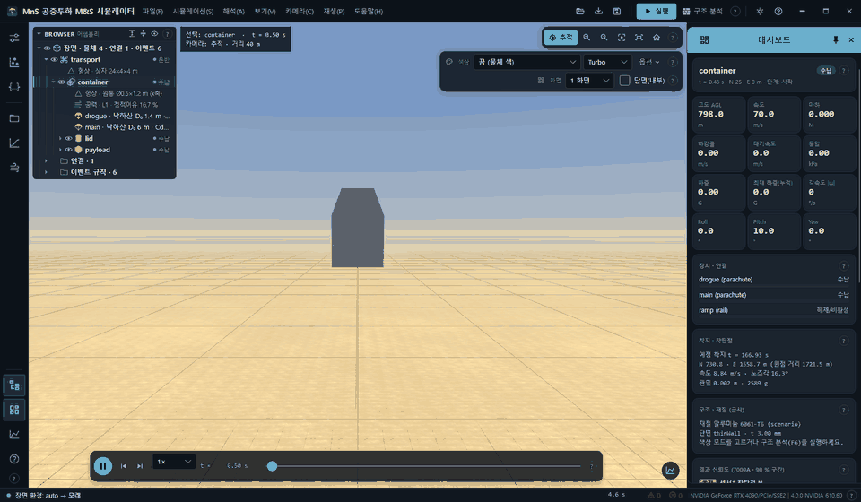

*데모 1(`demo_01_cargo_airdrop`) — 수송기 후방 램프에서 컨테이너가 미끄러져 나가 덮개가 떨어지고, 드로그 → 주낙하산 → 탑재물 분리 → 착지까지. 모든 값은 공개 문헌 수준의 일반값입니다.*

---

## 한눈에 보기

| | |
| --- | --- |
| 🪂 **시나리오로 기술** | 운반체 · 물체 · 낙하산 · 레일 · 테더 · 이벤트를 JSON 한 파일로 적습니다. 엔진은 특정 물체를 모르고 이 요소들만 압니다. |
| 🧮 **6DOF 다물체 엔진** | RK4 적분, 분리 · 전개 · 해제 이벤트, 낙하산 충만 곡선과 개방하중, 바람 · Dryden 난류, 착지 충돌 · 관입까지 한 번에 계산합니다. |
| 🎲 **몬테카를로** | 어떤 숫자든 분포로 흔들어 CPU(전체 6DOF) 수백 번, GPU(질점 모델) 수만 번 돌리고 CEP · 95 % 타원 · 고장 비율을 냅니다. |
| 🏗️ **구조 · 충격** | 빠른 근사 구조 분석(F6)과 CalculiX(정적 · 진동 · 좌굴 · 모달 과도) · OpenCourant(착지 충돌) 연동으로 안전율을 봅니다. |
| 🌬️ **유동** | GPU 가상 풍동(XLB 격자 볼츠만)으로 흐름을 실시간으로 보고, OpenFOAM 결과(표면 압력 · 유선)를 3D 로 겹쳐 봅니다. |
| 📐 **CAD 와 렌더** | Fusion 내보내기 스크립트로 형상 · 질량특성 · 재료 물성을 가져오고, 결과 폴더를 Blender 로 넘겨 렌더합니다. |
| ✅ **신뢰도 표시** | 공개 문헌 검증 사례와 NASA-STD-7009A 8요인 채점으로 결과마다 신뢰 · 참고 · 추정 등급과 90 % 구간을 붙입니다. |
| 🔄 **자동 업데이트** | 설치판은 GitHub 릴리스를 하루 한 번 확인하고, 내려받아 SHA-256 을 검증한 뒤 조용히 설치합니다. |

| | |
| --- | --- |
| 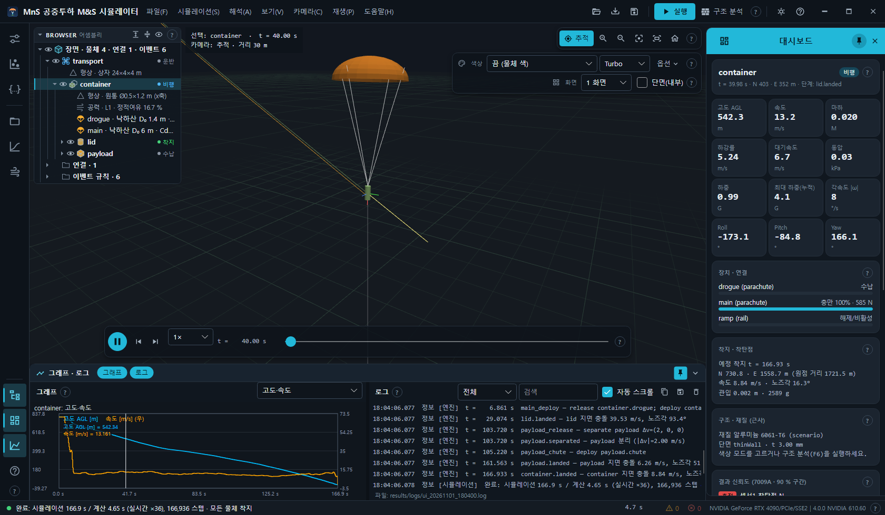 | 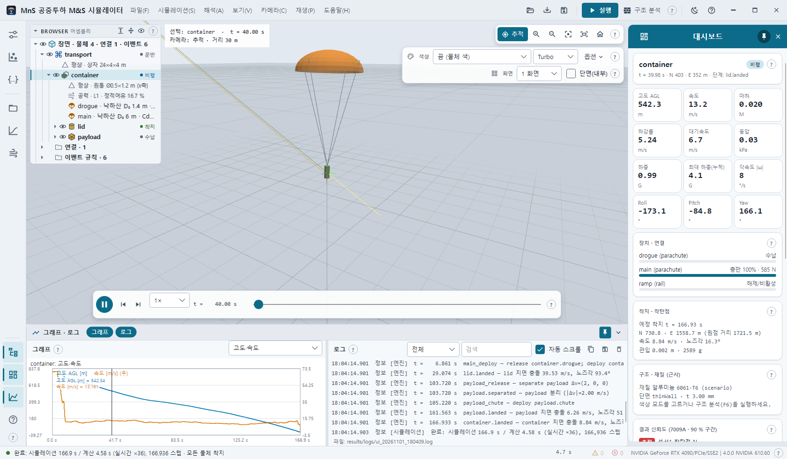 |
| **메인 화면** — 브라우저 · 3D 뷰 · 대시보드 · 그래프/로그 (다크) | 같은 장면, 라이트 테마 |

> 상태: 연구 · 개념 검토용. 공력 · 낙하산 계수의 신뢰도는 물체마다 따로 확인해야 합니다 — 결과 수치는 화면 · 보고서의 신뢰도 표시와 함께 보십시오.

## 전체 구조


## 설치 · 자동 업데이트

1. [Releases](https://github.com/ghlee0786/open-ms/releases) 에서 **`OpenMS-Setup-<버전>.exe`** 를 받아 실행합니다. 관리자 권한이 필요 없습니다(`%LOCALAPPDATA%\Programs\OpenMS` 에 설치, 시작 메뉴 **Open M&S**). .NET 런타임이 함께 들어 있습니다.
2. 같은 릴리스의 `OpenMS-Setup-<버전>.exe.sha256` 으로 파일을 확인할 수 있습니다. 압축판 `OpenMS-v<버전>-win-x64.zip` 도 있지만 자동 업데이트는 설치판 기준입니다.
3. 첫 실행 뒤 **파일 → 시나리오 열기…** 로 `config/scenarios/demo_01_cargo_airdrop.json` 을 열고 **F5** 로 실행, **Space** 로 재생합니다.


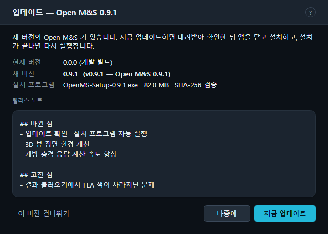

- 시작 5초 뒤 하루 한 번 확인합니다. **도움말 → 업데이트 확인…** 은 언제든 되고, **도움말 → 시작할 때 업데이트 자동 확인** 으로 끌 수 있습니다.
- 오프라인 · 릴리스 없음 · 요청 한도 초과는 대화상자 없이 로그만 남깁니다. 소스에서 빌드한 개발 빌드(버전 0.0.0)는 확인하지 않습니다.
- 자세히: [매뉴얼 1장 — 설치 · 자동 업데이트](docs/manual/01-install-update.md)

## 기능

### 1. 공중투하 이벤트 시퀀스


- 이벤트 조건: 시간 · 고도 · 속도 · 거리 · 가속도 · 장력과 그 조합(`and` · `or` · `after`). 동작: 분리 · 전개 · 해제 · 레일 시작 · 구성 교체 · 충격 펄스.
- 낙하산: 라인 신장 → 충만 곡선 → 개방하중, 리핑(단계 개방), 고장 주입(부분 충만).
- 재생 메뉴의 **이전/다음 이벤트**(PageUp/PageDown)로 이벤트 사이를 건너뛰며 봅니다.
- 시나리오 형식: [docs/scenario-schema.md](docs/scenario-schema.md) · 매뉴얼 [6장 — 시나리오](docs/manual/06-scenario.md) · [4장 — 3D 뷰 · 카메라 · 재생](docs/manual/04-3d-view-camera-playback.md)

### 2. 몬테카를로 · 분산 · 신뢰도


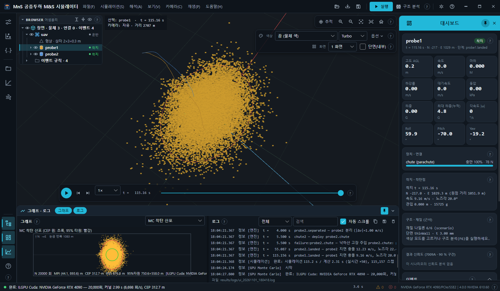

- **CPU Monte Carlo (전체 6DOF)** — 시나리오의 `dispersions[]` 를 LHS 로 뽑아 매번 전체 모델을 다시 풉니다(Esc 로 취소).
- **GPU Monte Carlo (단순 모델)** — `gpuMonteCarlo` 절의 질점 + 낙하산 모델을 ILGPU(CUDA)로 수만 번 돌립니다. GPU 가 없으면 CPU 로 대신합니다.
- **결과 신뢰도** — `mns credibility` 가 입력 출처 등급 · 불확도 정량화 · 7009A 8요인을 채점하고, 앱의 대시보드와 해석 메뉴가 그 결과를 보여 줍니다.
- 매뉴얼 [7장 — Monte Carlo · 결과 신뢰도](docs/manual/07-monte-carlo-credibility.md)

### 3. 구조 · 충격 해석


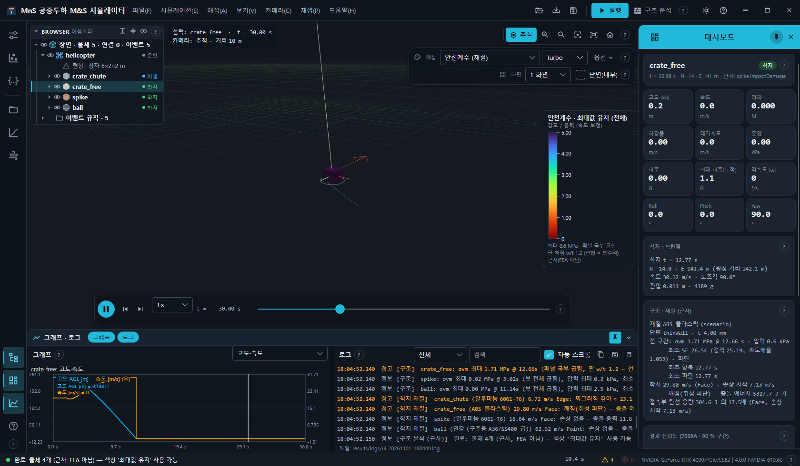

- **구조 분석 (F6)** — 전 구간 최대 하중 · 최초 항복/파단 시각을 근사 응력으로 바로 냅니다. 착지 손상(손상 없음 · 찌그러짐 · 깨짐)도 판정합니다.
- **CalculiX (F7)** — 선택 물체의 정적 · 고유진동 · 좌굴, 낙하산 개방 충격 창의 모달 과도 응답. **OpenCourant** — 착지 충돌 양해법.
- **진동 피로(근사)** — 와류 흘림 주파수와 고유진동수의 공진 여유, 공개 S-N 곡선 · Miner 손상.
- 매뉴얼 [8장 — 구조 · 충격 · FEA](docs/manual/08-structural-impact.md)

### 4. 유동 — GPU 가상 풍동 · CFD 결과

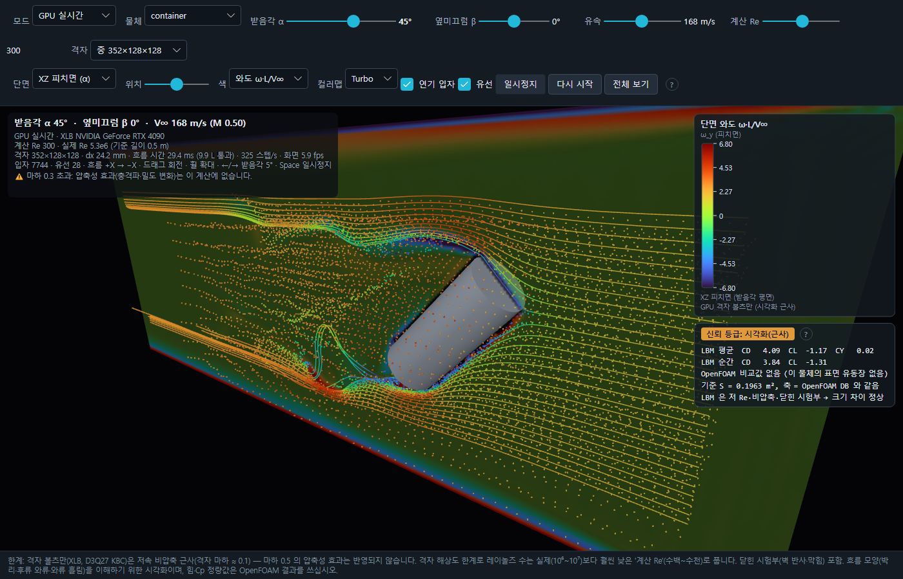

- **GPU 가상 풍동 (Shift+F8)** — XLB(격자 볼츠만) + NVIDIA Warp 로 선택 물체 주위 흐름을 실시간으로 그립니다(시각화용 근사).
- **풍동 보기 (F8)** — OpenFOAM 등 CFD 결과의 표면 압력 · 3-D 유선 · 입자 흐름을 물체에 겹쳐 봅니다.
- 두 도구는 같은 유동 영역 · 격자 규칙(`tools/flowdomain.py`)을 씁니다.
- 매뉴얼 [9장 — 유동](docs/manual/09-flow-wind-tunnel.md)

### 5. 장면 환경


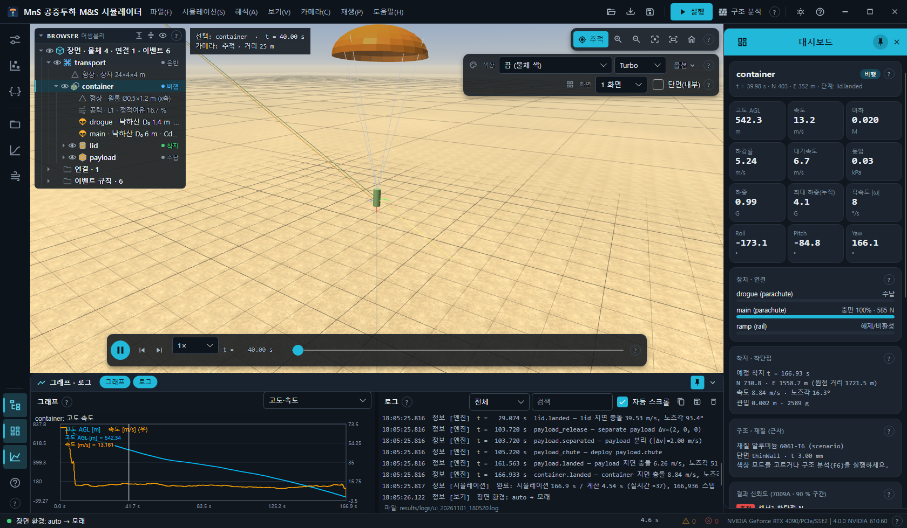

- 보기 → **장면 환경**: 기본(분석) · 풀밭 · 흙 · 모래 · 암반 · 눈 · 숲 가장자리, 그리고 시나리오 토양에 맞추는 **자동**.
- 밝기 · 노출 · 환경 회전 · 지면 반사 · 그림자 · 안개를 조절하고, 사용자 환경(`environment.json` · 정거원통 `.hdr`/`.png`)을 불러올 수 있습니다.
- 매뉴얼 [5장 — 장면 환경](docs/manual/05-scene-environment.md) · 형식 [config/environments/README.md](config/environments/README.md)

### 6. Fusion · Blender 연동

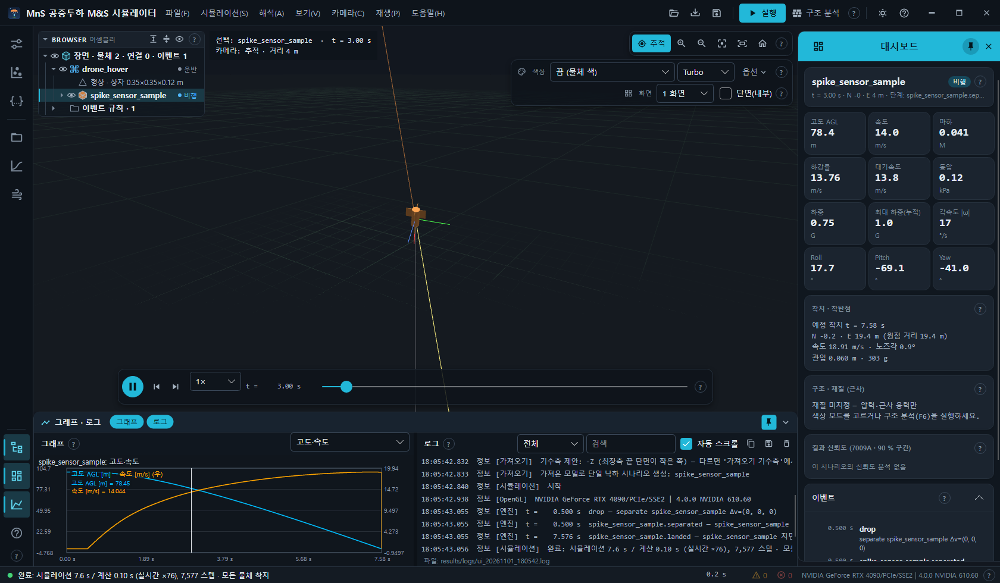

- `tools/fusion/MnS_ExportForSim` 스크립트가 바디를 `<이름>.stl` + `<이름>.massprops.json`(SI 질량 · CG · 관성, 재료 물성 · 외관 · 사용자 파라미터 · 조인트, 선택 USD)으로 내보냅니다. 앱의 **파일 → 모델 가져오기 (Ctrl+I)** 로 불러옵니다.
- Fusion 이 없으면 `samples/fusion_export/` 의 합성 샘플로 시험할 수 있습니다.
- Blender: `blender --python tools/blender/import_mns_result.py -- <결과폴더> [--usd]`
- 매뉴얼 [10장 — Fusion · Blender](docs/manual/10-fusion-blender.md)

### 7. Fusion 해석 패키지 교차 검증


- `mns simpkg <pkg.adsksimpkg> --run [--modal] [--converge]` — Fusion 구조 해석 패키지의 형상 · 재료 · 하중 · 경계를 복원해 CalculiX 로 다시 풀고, Fusion 보고서 값과 나란히 비교합니다.
- 매뉴얼 [10.3절 — Fusion 해석 패키지](docs/manual/10-fusion-blender.md)

### 8. 결과 · 명령줄

- **결과 저장 (.mnsr)** — 계산 없이 다시 여는 결과 파일(Ctrl+S / Ctrl+L). **결과 폴더 내보내기** — `timeseries.csv` · `devices.csv` · `events.json` · `summary.json` · `scene.json` · `meshes/`.
- 명령줄 `mns` — `run` · `mc` · `gpumc` · `ccx` · `fea` · `simpkg` · `credibility` · `loads` · `tumble-study` · `validate-public` 등.
- 매뉴얼 [11장 — 결과](docs/manual/11-results.md) · [12장 — 명령줄 mns](docs/manual/12-cli.md) · [13장 — 단축키](docs/manual/13-shortcuts.md)

## 데모 시나리오 (`config/scenarios/`)

| 파일 | 보여 주는 것 |
| --- | --- |
| `demo_01_cargo_airdrop.json` | 수송기 후방 램프 레일 사출 → 덮개 분리 → 드로그 → (감속 조건) 주낙하산 → 탑재물 분리 · 소형 낙하산 → 다물체 착지, 평균풍 + 난류, 모래 지면 |
| `demo_02_impact_materials.json` | 헬기에서 상자 · 스파이크 · 구 순차 투하, 리핑 낙하산 개방 충격, 낙하산 없는 상자의 착지 재질 판정, 관입, 흙 지면 |
| `demo_03_wind_dispersion.json` | 고도별 바람 표 + 강한 난류, 낙하산 고장 주입, CPU 6DOF · GPU 몬테카를로 착지 분산, 눈 지면 |

## 빌드 · 개발

```powershell
# .NET SDK 8 이상 (Windows x64)
dotnet build MnS.slnx
dotnet test  tests/Sim.Core.Tests
python -m pytest tools scripts -q     # Python 3.11 — Fusion 내보내기 · Blender 가져오기 · 샘플 · 변환기 · 문서 링크 검사

dotnet run --project src/Sim.App      # 앱 (개발 빌드 0.0.0 — 업데이트 확인 안 함)
dotnet run --project src/Sim.Cli -- run config/scenarios/demo_01_cargo_airdrop.json --structural
dotnet run --project src/Sim.Cli -- gpumc config/scenarios/demo_03_wind_dispersion.json --runs 100000
dotnet run --project src/Sim.Cli -- help

pwsh scripts/build-installer.ps1 -Version 0.1.0   # 설치 프로그램(Inno Setup 6 필요)
```

외부 해석기는 **선택** 입니다. 별도 프로세스로만 실행하며 이 저장소에 포함하거나 링크하지 않습니다. 없으면 그 기능과 해당 시험만 건너뜁니다.

| 도구 | 용도 | 찾는 곳 |
| --- | --- | --- |
| CalculiX 2.23 (GPL) | 정적 · 고유진동 · 좌굴 · 모달 과도 FEA (`mns ccx`, 앱 F7) | 인자 → `CCX_PATH` |
| Gmsh (pip) | STEP/STL → 사면체 메시 (`tools/fea/mesh_geometry.py`) | `MNS_PYTHON` |
| OpenCourant (AGPL) | 착지 충돌 · 파단 양해법 (`mns fea`) | `OPENCOURANT_PATH` |
| OpenFOAM (Docker) | 공력 계수 · 표면 압력 · 유선 (`tools/cfd`) | Docker Desktop |
| XLB + NVIDIA Warp | GPU 가상 풍동 (`tools/airflow`, 시각화 근사) | `tools/airflow/.venv` |

## 매뉴얼

전체 기능 매뉴얼(한국어): **[docs/manual](docs/manual/README.md)** — 설치 · 화면 구성 · 3D 조작 · 장면 환경 · 시나리오 · 몬테카를로 · 구조 · 유동 · Fusion/Blender · 결과 · 명령줄 · 단축키 · 자동 점검(스모크).

## 공개 검증 사례

`validation/public/*/case.json` 은 공개 문헌 자료로 만든 검증 사례입니다(원문 서지 · sha256 포함). `mns validate-public` 이 재현 · 판정해 보고서를 씁니다. 형식: [docs/validation-cases.md](docs/validation-cases.md).

| 분야 | 사례 |
| --- | --- |
| 6DOF · 대기 | NASA 6DOF check-case, US 1976 표준 대기 |
| 항력 | 원통(레이놀즈 수 · 횡류 · 유한 길이 · 마하), 구 · 정육면체 아임계, 구 자유 낙하 |
| 낙하산 | 십자형 개방하중, DGB 개방 · 하강 · 비행, 링세일 비행, 공개 하강률 등급 |
| 관입 · 회전체 | Young 토양 관입, 프로펠러 정적 추력, 로터 VRS, 텀블링 원통 |

## 라이선스

라이선스 미정 — 모든 권리 보유.
