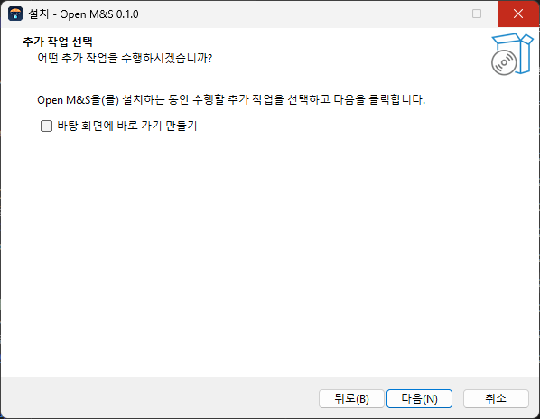
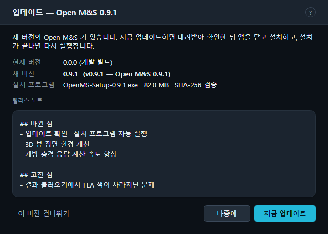
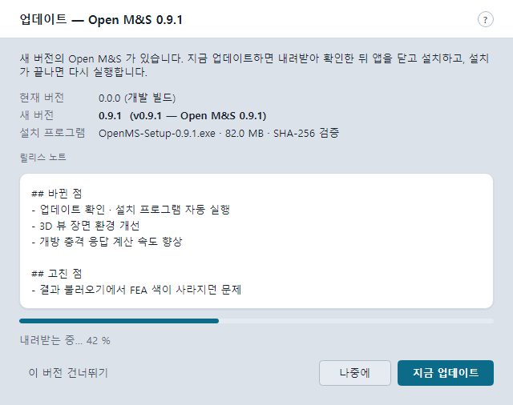
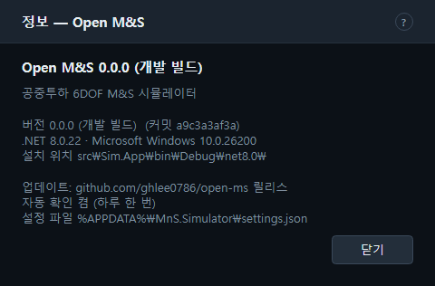

# 1. 설치 · 자동 업데이트 · 정보 · 제거

Open M&S 는 Windows(x64)용 데스크톱 앱(`MnS.Simulator.exe`)과 명령줄 도구(`mns`)로 이루어집니다.
설치 프로그램으로 설치하면 GitHub 릴리스에 새 버전이 나왔을 때 알려 주고, 고르면 스스로 업데이트합니다.

## 1.1 설치 프로그램으로 설치

1. GitHub 릴리스(`github.com/ghlee0786/open-ms/releases`)에서 **`OpenMS-Setup-<버전>.exe`** 를 받습니다.
   같은 릴리스의 `OpenMS-Setup-<버전>.exe.sha256` 으로 파일이 온전한지 확인할 수 있습니다(`hash  파일이름` 형식).
2. 실행하면 한국어 설치 마법사가 뜹니다. **관리자 권한이 필요 없습니다** — 사용자 계정에만 설치합니다.
   - 설치 위치: `%LOCALAPPDATA%\Programs\OpenMS`
   - 시작 메뉴: **Open M&S**
   - 선택 작업 "바탕 화면에 바로 가기 만들기"(기본 꺼짐)
3. 마지막 쪽의 **Open M&S 실행** 으로 바로 시작합니다.

설치되는 것: 앱 실행 파일 폴더(.NET 런타임 포함 — 따로 설치할 필요 없음), `config\`(시나리오 · 장면 환경),
`samples\`(공개 합성 샘플 모델), `tools\`(Fusion · Blender · GPU 가상 풍동 도구), `validation\public\`(공개 검증 사례)과 보고서 일부.

> 압축 파일 `OpenMS-v<버전>-win-x64.zip`(+ `.sha256`)도 같은 릴리스에 있습니다. 풀어서 `MnS.Simulator.exe` 를 바로 실행할 수 있지만,
> 이 방식은 자동 업데이트가 설치 프로그램을 내려받아 덮어쓰는 흐름과 맞지 않으므로 설치 프로그램을 권합니다.

### 소스에서 실행(개발 빌드)

.NET 8 SDK 가 있으면 저장소 루트에서 `dotnet run --project src/Sim.App` 로 실행합니다. 소스 빌드의 버전은 `0.0.0`(개발 빌드)이며
**업데이트를 확인하지 않습니다.** 정보 창에는 `0.0.0 (개발 빌드)` 로 보입니다.

### 창은 하나만

대화형 앱 창은 한 번에 하나만 뜹니다. 이미 실행 중일 때 다시 실행하면 새 창을 띄우지 않고 끝납니다(자동 점검 실행 `--smoke` 는 예외 — [14장](14-headless-smoke.md)).

## 1.2 자동 업데이트

| 항목 | 동작 |
| --- | --- |
| 언제 확인 | 앱 창이 열린 뒤 **5초 후**, **하루에 한 번**(마지막 확인 후 1일이 지났을 때). 개발 빌드는 확인하지 않음 |
| 켜고 끄기 | 도움말 → **시작할 때 업데이트 자동 확인 (하루 한 번)** 체크(기본 켬) |
| 직접 확인 | 도움말 → **업데이트 확인…** — 건너뛰기로 한 버전도 다시 보여 줌 |
| 확인 대상 | GitHub 릴리스의 최신 정식 릴리스(초안 · 사전 릴리스 `v1.2.3-beta` 등은 제외). 태그 `v1.2.3` 을 버전 1.2.3 으로 읽음 |
| 새 버전이 없을 때 | 자동 확인은 로그에만 남기고 조용히 넘어감. 오프라인 · GitHub 요청 한도도 로그만 |

새 버전이 있으면 **업데이트 — Open M&S x.y.z** 대화상자가 뜹니다.

- 현재 버전 · 새 버전(태그 · 릴리스 이름) · 설치 프로그램(파일 이름 · 크기 · `SHA-256 검증` 또는 `해시 검증 자산 없음`) · **릴리스 노트**(1,500자까지).
- **[지금 업데이트]** — 설치 프로그램(`OpenMS-Setup-<버전>.exe`)을 `%TEMP%\OpenMS-Update\` 로 내려받고(`내려받는 중… n%`),
  릴리스의 `.sha256` 으로 **SHA-256 을 확인**한 뒤 설치 프로그램을 조용히 실행(`/SILENT /SUPPRESSMSGBOXES /NORESTART /CLOSEAPPLICATIONS`)하고 앱을 닫습니다.
  설치가 끝나면 앱이 **다시 실행**됩니다.
- **[나중에]** — 닫기. 다음 날 자동 확인 때 다시 묻습니다.
- **[이 버전 건너뛰기]** — 이 버전은 자동 확인에서 다시 묻지 않습니다(도움말 → 업데이트 확인… 에서는 계속 보임).

해시가 맞지 않거나 `.sha256` 을 읽지 못하면 내려받은 파일을 지우고 **설치하지 않습니다**(`SHA-256 불일치 — …`).
릴리스에 `.sha256` 자산이 없으면 로그에 알리고 검증 없이 진행합니다. 실패하면 주 단추가 **[다시 시도]** 로 바뀝니다.

직접 확인(업데이트 확인…)의 결과 상자는 `최신 버전입니다.` · `개발 빌드입니다.` · `새 버전에 설치 프로그램이 없습니다.` ·
`업데이트를 확인하지 못했습니다.` 가운데 하나와 자세한 문장을 보여 줍니다.

### 업데이트 설정 저장

사용자 설정 파일 `%APPDATA%\MnS.Simulator\settings.json` 의 `"update"` 에 `autoCheck` · `skippedVersion` · `lastCheckUtc` 가 저장됩니다.
같은 파일에 테마 · 장면 환경 설정도 있으며, 설치 · 제거해도 남습니다. 확인 주소는 환경 변수 `MNS_UPDATE_API` 로 바꿀 수 있습니다(시험용).

## 1.3 정보 (버전)

도움말 → **정보 (버전)…** 은 앱 이름 · 버전(커밋) · .NET · OS · 설치 위치 · 업데이트 상태(자동 확인 켬/끔 · 마지막 확인 시각 · 건너뛴 버전) ·
설정 파일 위치를 보여 줍니다.

## 1.4 제거

Windows 설정 → **앱** → **Open M&S** → 제거. 제거 프로그램은 실행 중인 앱을 먼저 닫고, 앱 폴더의 `results\logs` · `results\smoke` 를 지운 뒤
비어 있는 폴더를 정리합니다. 다른 곳에 저장한 결과(.mnsr)와 `%APPDATA%\MnS.Simulator\settings.json` 은 남습니다.

## 1.5 직접 설치 프로그램 만들기 (개발자)

- `.\scripts\build-installer.ps1 -Version 1.2.3 [-SkipPublish]` — `dotnet publish`(win-x64, 자체 포함)로 `publish\win-x64` 를 만들고
  Inno Setup 6(`ISCC`)으로 `installer\Output\OpenMS-Setup-1.2.3.exe` 를 만듭니다. 버전은 `1.2.3` 꼴이어야 합니다.
- 설치 정의: `installer/OpenMS.iss`(앱 ID 는 바꾸지 않습니다 — 바꾸면 업데이트가 다른 앱으로 설치됨).
- CI(`.github/workflows/ci.yml`): 모든 브랜치 push · PR 에서 Windows 에 .NET 8 · 10 을 설치하고 `dotnet build` · `dotnet test`, 시험 결과(trx)를 올립니다.
- 릴리스(`.github/workflows/release.yml`): 태그 `v1.2.3` 을 push 하면 시험 → 설치 프로그램 · zip 빌드 → SHA-256 → GitHub 릴리스(자동 릴리스 노트)를
  만들고 `OpenMS-Setup-<버전>.exe` · `.exe.sha256` · `OpenMS-<태그>-win-x64.zip` · `.zip.sha256` 을 올립니다. 태그에 `-` 가 있으면 사전 릴리스(자동 업데이트 대상 아님).
