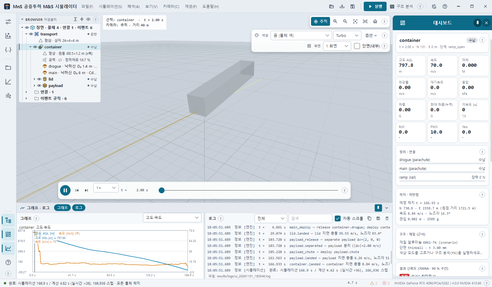

# 2. 빠른 시작 — 첫 실행 · 데모 열기 · 실행 · 재생

## 2.1 첫 실행

앱을 켜면 `config/scenarios` 의 **첫 시나리오(파일 이름순)** 를 불러와 바로 한 번 실행합니다. 공개 배포본에서는
`demo_01_cargo_airdrop` 이 처음 열립니다. 테마는 기본 다크이며, 바꾼 테마는 다음 실행에도 유지됩니다([3장](03-screen-layout.md#36-테마)).

처음 화면: 위쪽 제목 표시줄(메뉴 · 빠른 단추), 본문 전체의 3D 뷰, 왼쪽 아이콘 레일, 3D 왼쪽 위의 브라우저(어셈블리),
오른쪽 대시보드, 아래 그래프 · 로그 서랍, 맨 아래 상태 표시줄. 왼쪽 입력 서랍은 닫혀 있습니다.

## 2.2 데모 시나리오 열기

1. 왼쪽 레일 맨 위 **입력** 아이콘(조절 막대 모양)을 누르면 레일 오른쪽에 서랍이 열립니다.
2. **시나리오** 목록에서 `demo_01_cargo_airdrop` · `demo_02_impact_materials` · `demo_03_wind_dispersion` 가운데 하나를 고릅니다 — 고르면 바로 불러옵니다(아직 실행 전).
3. 옆의 **설명** 단추는 그 시나리오의 설명 원문을 별도 창으로 보여 줍니다.

다른 위치의 파일은 **열기…**(Ctrl+O) 또는 `.json` 파일을 창에 끌어다 놓아 엽니다. 데모 3종의 내용은 [6장](06-scenario.md#65-공개-데모-시나리오-3종)에 있습니다.

## 2.3 실행 (F5)

- 제목 표시줄의 주색 **[실행]**, 입력 서랍의 **시뮬레이션 실행**, 시뮬레이션 → 실행, 또는 **F5**.
- 실행 전 입력 서랍의 투하 조건(고도 · 속도 · 방위 · 풍속 · 풍향 · 난류 · dt)이 시나리오에 반영됩니다.
- 진행은 3D 아래 진행 상자와 상태 표시줄에 3단계로 표시됩니다:
  `1/3 시나리오 검증 · 물체 · 형상 생성` → `2/3 적분 (6DOF RK4, dt … ms)` (t / tEnd 진행률) → `3/3 결과 요약 · 3D 장면 생성`.
- **Esc** 로 취소하면 그때까지의 부분 결과를 보여 줍니다.
- 끝나면 로그에 `완료: 시뮬레이션 … s / 계산 … s (실시간 ×…) , … 스텝 · <종료 이유>` 가 남고, 재생이 처음부터 1× 로 시작합니다.

실행 중에는 실행 · 열기 · 가져오기 · MC · JSON 적용 · 구조 분석 단추가 잠깁니다(한 번에 작업 하나).

## 2.4 재생 · 확인

| 하고 싶은 것 | 방법 |
| --- | --- |
| 재생 / 일시정지 | 재생 막대의 둥근 단추 · **Space** (끝에서 누르면 처음부터) |
| 시간 이동 | 재생 막대 슬라이더 끌기 · 그래프 클릭 · 이벤트 목록 클릭 |
| 이벤트로 이동 | 재생 막대 ⏮ ⏭ · **PageUp / PageDown** |
| 한 프레임씩 | **,** (이전) · **.** (다음) — 재생이 멈춤 |
| 처음으로 | **Ctrl+Home** |
| 재생 속도 | 재생 막대 콤보 0.001× ~ 50× (0.005× 이하 = 충격 슬로모션) |
| 물체 보기 | 3D 에서 물체 클릭 또는 브라우저 행 클릭 → 대시보드 · 그래프 · 브라우저가 그 물체로 |

## 2.5 다음 단계

- **구조 분석 F6** — 응력 · 안전계수 · 부위 상태 색과 최초 항복/파단 이벤트([8장](08-structural-impact.md)).
- **Monte Carlo** — 착지 산포 · CEP([7장](07-monte-carlo-credibility.md)).
- **장면 환경** — 보기 → 장면 환경 → 자동(시나리오 토양)([5장](05-scene-environment.md)).
- **저장 Ctrl+S** — 결과를 `.mnsr` 한 파일로 저장하고 나중에 Ctrl+L 로 계산 없이 다시 보기([11장](11-results.md)).
- 화면 곳곳의 작은 **?** 는 그 섹션 설명 말풍선, **F1** 은 전체 도움말 창입니다([13장](13-shortcuts.md)).
