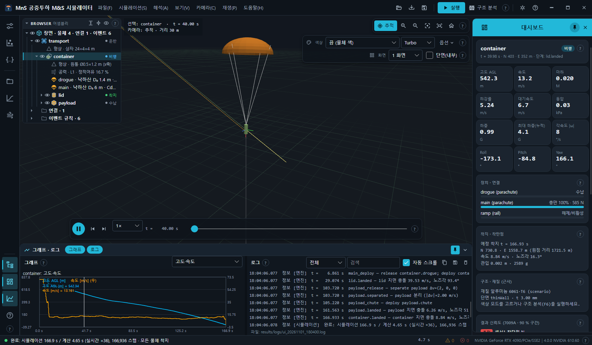
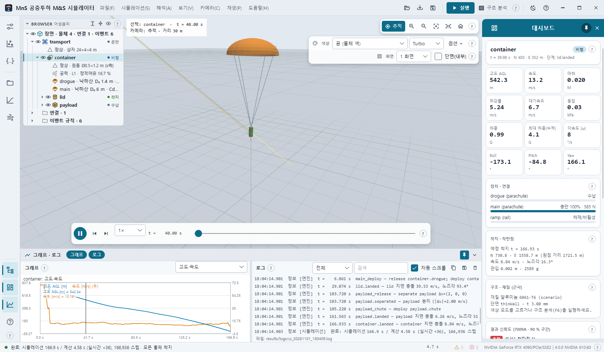
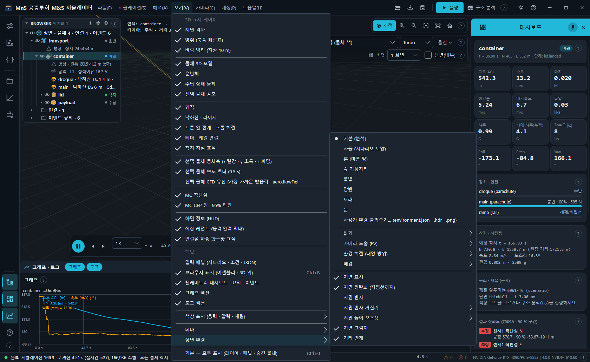
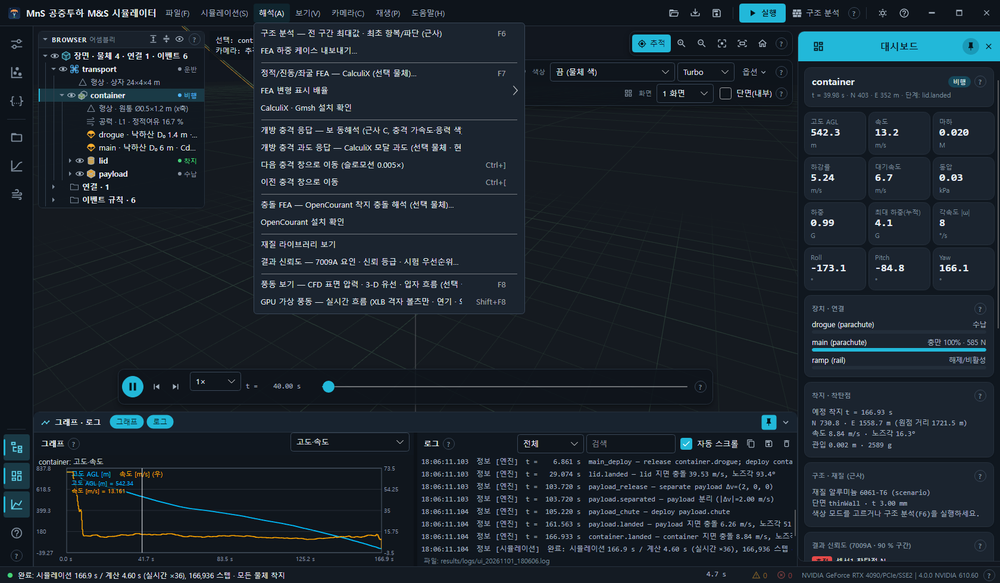
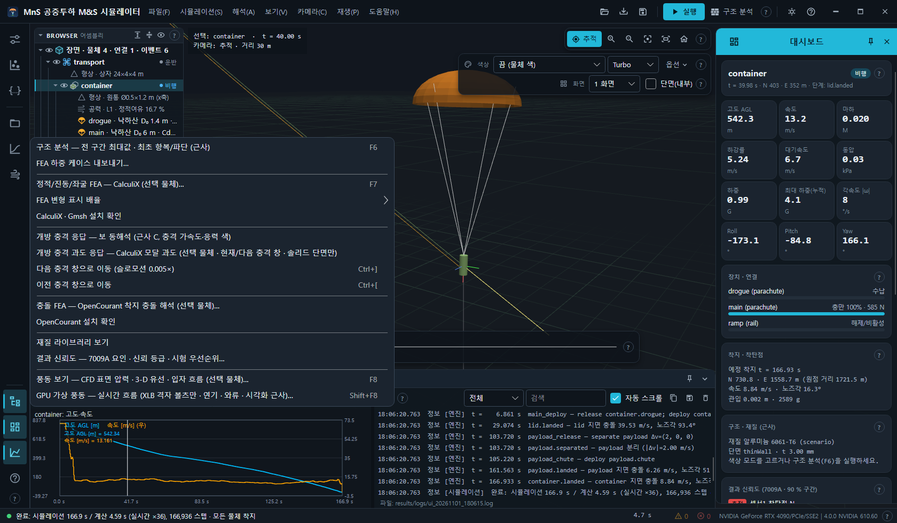
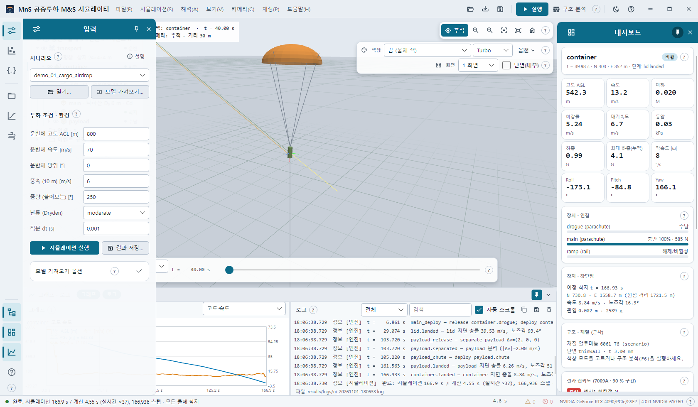
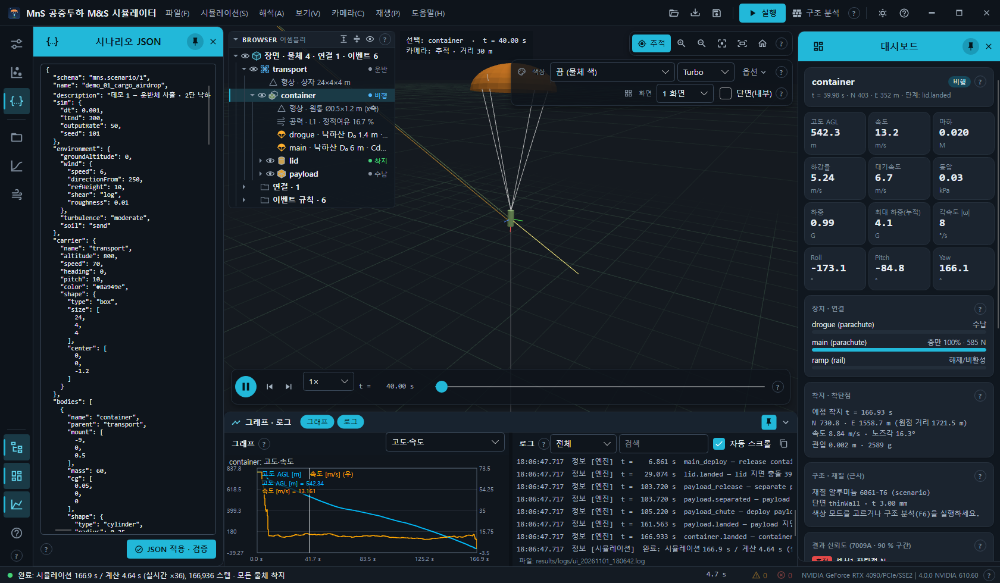
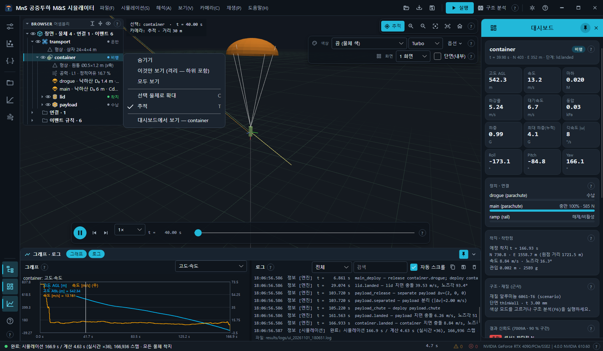
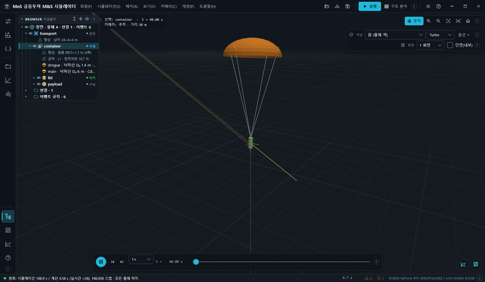
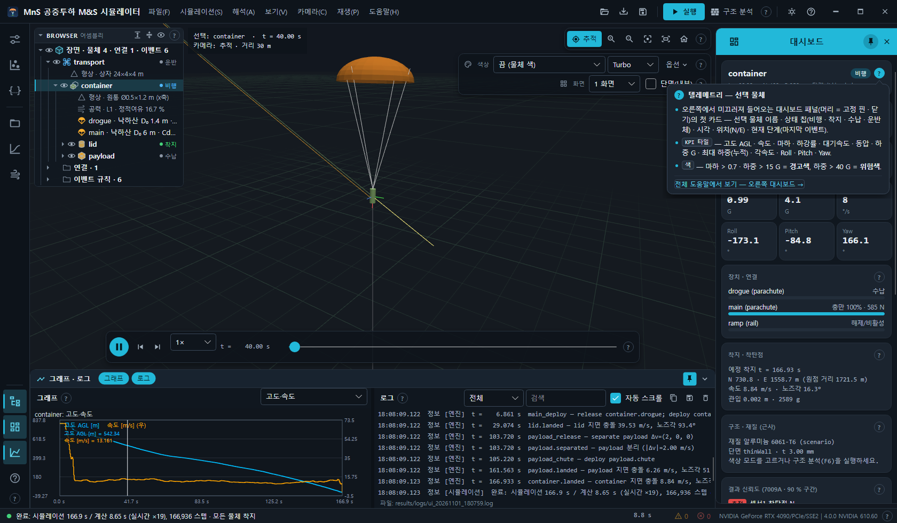

# 3. 화면 구성

**3D 뷰가 본문 전체**를 차지하고, 그 위에 레일 · 서랍 · 패널 · 떠 있는 막대가 겹칩니다.

| 위치 | 이름 | 내용 |
| --- | --- | --- |
| 맨 위 | 제목 표시줄 | 앱 아이콘 · 제목 · 메뉴 7개 · 빠른 단추 · 테마 · 도움말 · 창 단추 |
| 왼쪽 끝 | 아이콘 레일 | 서랍 페이지 · 묶음 메뉴 · 패널 켜기 · 도움말 |
| 레일 오른쪽 | 왼쪽 서랍 | 입력 · Monte Carlo · 시나리오 JSON 페이지 |
| 3D 왼쪽 위 | 브라우저 (어셈블리) | 물체 계층 · 눈(표시) · 상태 |
| 3D 오른쪽 위 | 카메라 막대 · 표시 막대 | 카메라 단추 / 색상 · 컬러맵 · 옵션 · 화면 분할 · 카메라 동기 · 단면 |
| 3D 아래 | 재생 막대 | 재생 · 이벤트 이동 · 속도 · 시각 · 시간 슬라이더 |
| 오른쪽 | 대시보드 | 선택 물체 카드 · KPI 타일 · 장치 · 착지 · 구조 · 신뢰도 · 이벤트 · 결과 요약 |
| 아래 | 그래프 · 로그 서랍 | 그래프 섹션 · 로그 섹션 |
| 맨 아래 | 상태 표시줄 | 작업 · 진행 · 경과 · 취소 · 경고/오류 수 · OpenGL 정보 |

## 3.1 제목 표시줄 · 메뉴

빈 곳을 끌면 창 이동, 더블클릭하면 최대화 ↔ 복원입니다. 창 폭이 좁으면(약 1,320 px 미만) 제목 글을 숨겨 메뉴 자리를 지킵니다.

**메뉴 7개** — 모든 기능이 메뉴에 있습니다.

| 메뉴 | 항목 | 장 |
| --- | --- | --- |
| 파일(F) | 시나리오 열기… (Ctrl+O) · 모델 가져오기 (Fusion STL/JSON)… (Ctrl+I) · 결과 불러오기 (.mnsr)… (Ctrl+L) · 결과 저장 (.mnsr)… (Ctrl+S) · 결과 폴더 내보내기 (CSV · Blender · scene)… · 3D 화면 캡처 (PNG)… · 로그 저장… · 종료 (Alt+F4) | [6](06-scenario.md) · [10](10-fusion-blender.md) · [11](11-results.md) |
| 시뮬레이션(S) | 실행 (F5) · 실행 중인 작업 취소 (Esc) · GPU Monte Carlo (단순 모델) · CPU Monte Carlo (전체 6DOF) · 시나리오 JSON 적용·검증 | [2](02-quick-start.md) · [7](07-monte-carlo-credibility.md) · [6](06-scenario.md) |
| 해석(A) | 구조 분석 (F6) · FEA 하중 케이스 내보내기… · 정적/진동/좌굴 FEA — CalculiX (F7) · FEA 변형 표시 배율 · CalculiX · Gmsh 설치 확인 · 개방 충격 응답 · 개방 충격 과도 응답(CalculiX) · 다음/이전 충격 창으로 이동 (Ctrl+] / Ctrl+[) · 충돌 FEA — OpenCourant · OpenCourant 설치 확인 · 재질 라이브러리 보기 · 결과 신뢰도 · 풍동 보기 (F8) · GPU 가상 풍동 (Shift+F8) | [8](08-structural-impact.md) · [7](07-monte-carlo-credibility.md) · [9](09-flow-wind-tunnel.md) |
| 보기(V) | 3D 표시 레이어 · 패널 · 색상 표시 · 테마 · 장면 환경 · 기본 — 모두 표시 (Ctrl+0) | [4](04-3d-view-camera-playback.md) · [5](05-scene-environment.md) |
| 카메라(C) | 선택 물체 추적 (T) · 선택 물체로 확대 (C) · 전체 보기 (F) · 카메라 초기화 (Home) · 확대 · 축소 · 위에서 (1) · 정면 (2) · 측면 (3) · 등각 (4) | [4](04-3d-view-camera-playback.md) |
| 재생(P) | 재생 / 일시정지 (Space) · 처음으로 (Ctrl+Home) · 이전 프레임 (,) · 다음 프레임 (.) · 이전 이벤트 (PageUp) · 다음 이벤트 (PageDown) | [4](04-3d-view-camera-playback.md) |
| 도움말(H) | 도움말 · 조작법 · 단축키 (F1) · 현재 시나리오 설명… · 업데이트 확인… · 시작할 때 업데이트 자동 확인 (하루 한 번) · 정보 (버전)… | [13](13-shortcuts.md) · [6](06-scenario.md) · [1](01-install-update.md) |

**빠른 단추**(제목 표시줄 오른쪽): 열기(폴더) · 불러오기(트레이 화살표) · 저장(디스크) | **실행**(주색) · **구조 분석** | 테마(해 · 달) · 도움말(?) ·
최소화 · 최대화 · 닫기. 마우스를 올리면 이름과 단축키가 나옵니다. 작업 중에는 열기 · 불러오기 · 실행 · 구조 분석이 잠깁니다.

## 3.2 왼쪽 아이콘 레일 · 서랍

| 레일 아이콘 | 동작 |
| --- | --- |
| 입력 | 서랍 '입력' 페이지 열기 · 같은 아이콘 다시 = 접기 |
| Monte Carlo | 서랍 'Monte Carlo' 페이지 |
| 시나리오 JSON | 서랍 '시나리오 JSON' 페이지 |
| 결과 · 파일 | 레일 오른쪽에 파일 메뉴와 같은 목록 |
| 해석 | 해석 메뉴와 같은 목록 |
| 풍동 | 풍동 보기 (F8) · GPU 가상 풍동 (Shift+F8) |
| 브라우저 (아래) | 브라우저 숨기기 · 보이기 (Ctrl+B) |
| 대시보드 (아래) | 대시보드 열기 · 닫기 |
| 그래프 · 로그 (아래) | 아래 서랍 열기 · 닫기 |
| 도움말 (아래) | 도움말 창 (F1) |

선택된 아이콘은 왼쪽 주색 막대 + 옅은 바탕으로 표시됩니다. 묶음 아이콘(결과 · 파일 · 해석 · 풍동)의 목록은 메인 메뉴 항목을 그대로 복제한 것이라
단축키 · 사용 가능 · 체크 상태가 같고 누르면 같은 동작을 합니다.

**왼쪽 서랍** — 기본은 3D 위에 **겹쳐 뜨며**, 3D 를 누르거나 **Esc** 를 누르면 닫힙니다. 머리의 **핀**을 켜면 고정되어 3D 장면이 서랍을 비켜 그립니다.
오른쪽 가장자리를 끌면 폭(260~560 px), 더블클릭하면 기본 폭(320)입니다. 페이지 내용은 [6장](06-scenario.md)(입력 · JSON)과 [7장](07-monte-carlo-credibility.md)(Monte Carlo).

## 3.3 브라우저 (어셈블리)

3D 장면 왼쪽 위에 겹친 반투명 패널입니다(분할 화면이면 GL 영역 전체의 왼쪽 위). 운반체 → 물체 → 하위 물체 계층과 형상 · 공력 · 장치(낙하산 · 로터 · 펄스) ·
연결(테더 · 레일 · 힌지 · 스윙) · 이벤트 규칙을 보여 줍니다. 마우스를 올리면 전체 이름과 상세(질량 · 출처 등).

| 부분 | 동작 |
| --- | --- |
| ▾ · ▸ **BROWSER** 어셈블리 | 화살표나 제목 클릭 = 접기(머리줄만) · 펼치기 |
| 모두 펼치기 · 물체만 펼치기 · 모두 보기 | 머리줄 오른쪽 단추 |
| 행의 눈 | 3D 표시 · 숨김(하위 포함). 끄면 행이 흐려짐. 맨 위 '장면'의 눈 = 전체 |
| 종류 아이콘 | 어셈블리 · 물체(메시 · 상자 · 원통 · 구 · 외피 조각, 물체 고유 색) · 운반체 · 낙하산 · 로터 · 펄스 · 연결 · 형상/공력 정보 · 이벤트 규칙 · 묶음 |
| 상태 | 오른쪽 색 점 + 수납 / 비행 / 착지 — 재생 시각에 맞춰 갱신 |
| 클릭 · 더블클릭 | 선택(3D · 대시보드 · 그래프 동기) · 선택 + 확대 |
| 오른쪽 가장자리 끌기 | 폭 조절(210 px ~ 뷰 폭 55 %, 더블클릭 = 기본 280). 높이는 내용에 맞추되 뷰 높이의 약 72 %(4 분할이면 위 칸)까지, 넘으면 스크롤 |
| Ctrl+B | 브라우저 숨기기 · 보이기 |

패널 위의 클릭 · 휠 · 드래그는 패널이 받고 3D 카메라로 새지 않습니다. 브라우저가 보이면 HUD(선택 · 카메라 글)는 그 오른쪽으로 비킵니다.

### 오른쪽 클릭 메뉴

오른쪽 클릭한 행이 먼저 선택된 뒤 메뉴가 열립니다.

| 항목 | 동작 |
| --- | --- |
| 숨기기 / 보이기 | 그 행의 눈과 같음(글자가 상태에 따라 바뀜) |
| 이것만 보기 (격리 — 하위 포함) | 그 물체(하위 포함)만 남기고 모두 숨김 |
| 모두 보기 | 숨긴 물체를 모두 다시 표시 |
| 선택 물체로 확대 (C) | 카메라를 그 물체로 |
| 추적 (T) | 그 물체 따라가기 켜기/끄기(체크 표시) |
| 대시보드에서 보기 — <이름> | 대시보드를 열고 맨 위(선택 물체 카드)로 |

물체가 아닌 행(정보 · 연결 등)에서는 물체 전용 항목이 꺼집니다.

## 3.4 3D 뷰 위 떠 있는 요소

- **HUD**(왼쪽 위): `선택: <이름> · t = … s` / `카메라: 추적|자유 · 거리 … m · 숨김 n`.
- **카메라 막대**(오른쪽 위): 추적 · 확대 · 축소 · 선택 물체로 · 전체 보기 · 카메라 초기화 · ?([4장](04-3d-view-camera-playback.md)).
- **표시 막대**(그 아래): 색상 · 컬러맵 · 옵션 · ? / 화면 · 카메라 동기 · 단면(내부) · ?([4장](04-3d-view-camera-playback.md#44-색상-모드--레전드)).
- **레전드**(오른쪽 가운데): 색 모드를 켜면 범위 · 단위 · 눈금 · 출처.
- **진행 상자**(아래 가운데): 작업 이름(`(Esc 취소)`) · 단계 · 진행률. 입력은 통과합니다.
- **재생 막대**(아래): [4장](04-3d-view-camera-playback.md#43-재생-메뉴--재생-막대).
- **다시 열기 단추**(오른쪽 아래 둥근 단추): 대시보드나 아래 서랍을 닫으면 나타남 — 누르면 다시 열림.

## 3.5 대시보드 · 그래프 · 로그 · 상태 표시줄

### 대시보드 (오른쪽)

주색 머리 = 아이콘 · **대시보드** · 고정 핀 · 닫기. 왼쪽 가장자리 끌기 = 폭(280~620, 더블클릭 = 340).

| 카드 | 내용 |
| --- | --- |
| 머리 카드 | 선택 물체 이름 · 상태 칩(비행 · 착지 · 수납 · 운반체) · `t = … s · N … · E … m · 단계: <마지막 이벤트>` |
| KPI 타일 12개 | 고도 AGL · 속도 · 마하 · 하강률 · 대기속도 · 동압 · 하중 · 최대 하중(누적) · 각속도 \|ω\| · Roll · Pitch · Yaw. 마하 · 하중이 커지면 경고색 → 위험색 |
| 장치 · 연결 | 선택 물체의 낙하산(충만 % · 힘 N / 수납), 로터(추력), 펄스, 테더 장력 · 힌지 반력 막대 |
| 착지 · 착탄점 | (예정) 착지 시각 · N/E 위치 · 원점 거리 · 속도 · 노즈각 · 관입 깊이 · 관입 g |
| 구조 · 재질 (근사) | 재질(출처) · 단면 · 두께, 현재 σvm · 압력 · 최소 SF, 구조 분석 후 전 구간 최대 · 최초 항복/파단/좌굴 · 착지 손상 판정 |
| 결과 신뢰도 (7009A · 90 % 구간) | [7장](07-monte-carlo-credibility.md#73-결과-신뢰도-nasa-std-7009a) |
| 이벤트 | 시각 · 이름 · 설명. 누르면 그 시각으로 |
| 결과 요약 (접힘) | 실행 · 착지 · 그 밖의 물체 · 낙하산 · 테더 · 힌지 · 충돌 판정 · 지표 · 경고 섹션, **요약 텍스트 복사** 단추 |

### 그래프 · 로그 (아래 서랍)

머리 = **그래프** · **로그** 켜기 칩 · 고정 핀 · 닫기. 위 가장자리 끌기 = 높이(더블클릭 = 260), 가운데 경계선 = 두 섹션 폭.

- **그래프**: 콤보 `고도·속도` · `자세(롤·피치·요)` · `하중(G)·대기속도` · `MC 착탄 산포`. 선택 물체 기준 시간 이력.
  클릭 · 드래그 = 그 시각으로, 그래프에 포커스가 있을 때 ← / → = 기록 간격 한 칸(Shift = 10칸), 휠 = 시간축 확대, 오른쪽 · 가운데 드래그 = 구간 이동, 더블클릭 = 전체.
- **로그**: 수준 콤보(`전체` / `경고 · 오류` / `오류만`) · 검색(메시지 · 출처) · 자동 스크롤 · 복사 · 저장… · 지우기.
  세션 로그는 `results/logs/ui_<날짜_시각>.log` 에도 기록됩니다(섹션 아래 파일 이름).

### 상태 표시줄

색 점(정상 · 경고 · 오류 · 작업 중) · 현재 작업과 단계 · 진행 막대 · 경과 시간 · **취소 (Esc)** · 경고 배지 · 오류 배지(누르면 로그를 그 수준으로 엶) · OpenGL 정보.

### 패널 고정 · 겹침

| 상태 | 뜻 |
| --- | --- |
| 고정(핀 켬) | 3D 장면 영역이 그 패널을 비켜 그림 — 레전드 · 분할 칸이 가려지지 않음 |
| 겹침(핀 끔) | 3D 위에 떠서 겹침 — 재생 막대 · 카메라 막대는 겹친 패널 밖으로 비킴 |

기본: 대시보드 · 아래 서랍 고정, 왼쪽 서랍 겹침. 열고 닫을 때 0.2초 동안 미끄러지며 나타나고 사라집니다.
보기 → 패널 · 레일 아이콘 · 패널 머리의 닫기가 같은 상태를 바꾸고, **Ctrl+0** 은 모든 레이어 · 패널 · 숨긴 물체를 기본(모두 표시)으로 되돌립니다.

## 3.6 테마

다크 · 라이트 두 테마. 제목 표시줄의 해 · 달 단추(다크일 때 해, 라이트일 때 달) 또는 보기 → 테마.
고른 테마는 `%APPDATA%\MnS.Simulator\settings.json` 에 저장되어 다음 실행에 복원됩니다.
메뉴 · 패널 · 그래프 · 레전드 바탕 · 3D 배경과 격자 · 대화상자 · 도움말이 함께 바뀌지만, **데이터 색**(컬러맵 · 응력/압력/안전계수 척도 · 상태 색 ·
물체 고유 색 · MC 산포 색)은 바뀌지 않습니다. 풍동 창의 무대(3D 영역)는 두 테마 모두 어두운 바탕입니다.

## 3.7 섹션 도움말 ?

섹션마다 있는 작은 원형 **?** 를 누르면 그 섹션 옆에 말풍선 설명이 뜹니다(바깥 클릭 · Esc 로 닫기). 말풍선의 **전체 도움말에서 보기** 는 도움말 창의 해당 장을 엽니다.

## 3.8 끌어다 놓기

창에 파일을 끌어다 놓으면: `.mnsr` → 결과 불러오기, `.json`(massprops 제외) → 시나리오 열기, `.stl` · `.massprops.json` → 모델 가져오기 후 바로 실행.
