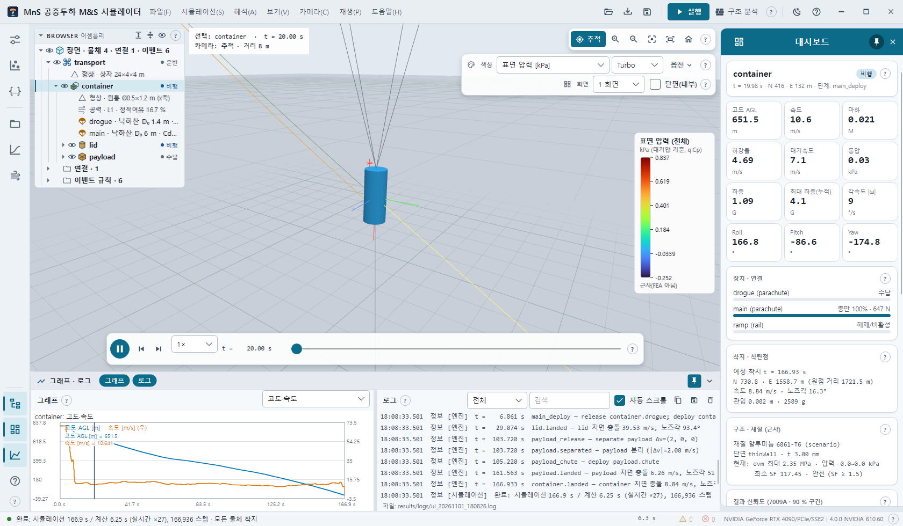
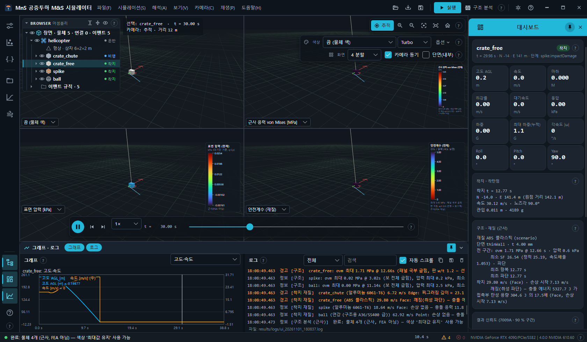
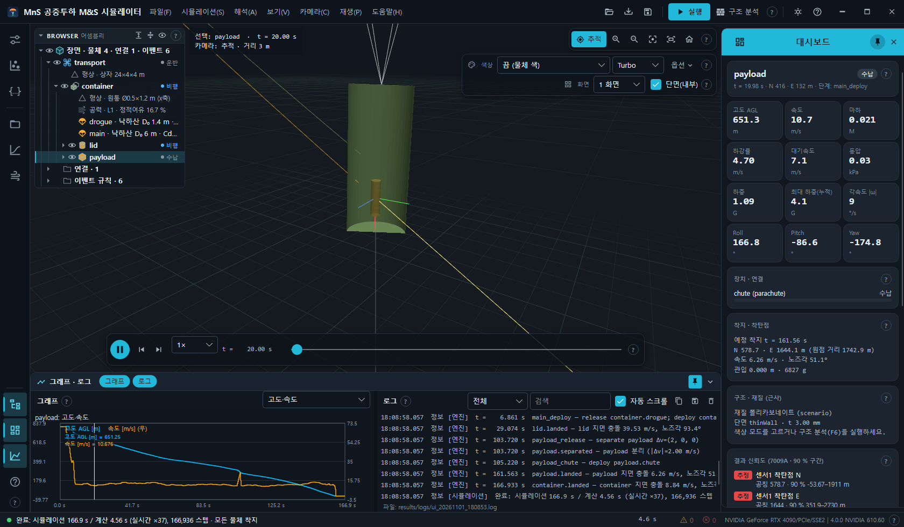

# 4. 3D 뷰 · 카메라 · 재생 · 색상 · 분할 · 단면 · 보기 메뉴

## 4.1 3D 뷰 조작

### 마우스

| 조작 | 동작 |
| --- | --- |
| 왼쪽 드래그 | 궤도 회전(선택 물체/초점 중심, 뷰 높이만큼 끌면 180°) |
| Ctrl + 왼쪽 드래그 | 제자리 시점 회전(카메라 위치 고정) |
| 오른쪽 드래그 · 가운데 드래그 · Shift + 왼쪽 드래그 | 화면 평면 이동(팬) — 잡은 점이 커서를 따라옴 |
| 휠 | 커서 아래 점 기준 확대 · 축소(최소 거리 0.1 m 에 닿으면 커서 방향으로 전진) |
| Ctrl + 휠 | 커서 방향으로 공간 전진 · 후진(한 칸 = 거리의 15 %, 계속 굴리면 가속) |
| 클릭 | 물체 선택 → 대시보드 · 그래프 · 브라우저 동기 |
| 더블클릭 | 물체: 선택 + 확대 / 빈 곳: 전체 보기 |

분할 화면에서는 누른 화면이 조작 대상입니다(강조 테두리).

### 키보드

입력칸 밖에서 동작합니다. 화살표 · Space · PageUp/Down · Home 은 3D 뷰 · 단추에 포커스가 있거나 포커스가 없을 때만(목록 · 슬라이더 탐색과 겹치지 않게).
메뉴가 열려 있으면 메뉴 탐색 키를 가로채지 않습니다.

| 키 | 동작 |
| --- | --- |
| W · S / A · D / E · Q | 누르는 동안 전진 · 후진 / 왼쪽 · 오른쪽 / 상승 · 하강. 속도는 확대 정도에 비례하고 오래 누르면 0.7초마다 두 배로 가속 |
| ← → ↑ ↓ | 화면 평면 이동 |
| Shift + 화살표 | 궤도 회전 |
| Ctrl + 화살표 | 제자리 시점 회전(2°) |
| + · − | 확대 · 축소 |
| T · C · F · Home | 추적 · 선택 물체로 확대 · 전체 보기 · 카메라 초기화 |
| 1 · 2 · 3 · 4 | 위에서(평면, 북쪽 위) · 정면(북쪽을 봄) · 측면(동쪽을 봄) · 등각 |

## 4.2 카메라 메뉴 · 카메라 막대

| 메뉴 항목 | 단축키 | 카메라 막대 단추 | 동작 |
| --- | --- | --- | --- |
| 선택 물체 추적 | T | 추적(조준점, 토글) | 선택 물체를 따라감 |
| 선택 물체로 확대 | C | 초점 틀 | 선택 물체로 확대(선택이 없으면 로그 경고) |
| 전체 보기 | F | 화면 맞춤 | 장면 전체가 보이게 |
| 카메라 초기화 | Home | 집 | 기본 거리(물체가 많으면 멀리)로, 추적 켬 |
| 확대 (+ · 휠) · 축소 (− · 휠) | + · − | 돋보기 + · − | 거리 ×0.8 · ×1.25 |
| 위에서 (평면, 북쪽 위) | 1 | — | 시점 프리셋 |
| 정면 (북쪽을 봄) | 2 | — | 〃 |
| 측면 (동쪽을 봄) | 3 | — | 〃 |
| 등각 | 4 | — | 〃 |

## 4.3 재생 메뉴 · 재생 막대

| 메뉴 항목 | 단축키 | 재생 막대 | 동작 |
| --- | --- | --- | --- |
| 재생 / 일시정지 | Space | 둥근 재생 단추 | 끝에서 누르면 처음부터. 아이콘이 재생 ↔ 일시정지로 |
| 처음으로 | Ctrl+Home | — | t = 0 |
| 이전 프레임 | , | — | 기록 프레임 하나 뒤로(재생 정지) |
| 다음 프레임 | . | — | 기록 프레임 하나 앞으로 |
| 이전 이벤트 | PageUp | ⏮ | 지금보다 앞의 이벤트 시각 |
| 다음 이벤트 | PageDown | ⏭ | 다음 이벤트 시각 |
| — | — | 속도 콤보 | `0.001×` `0.005×` `0.02×` `0.1×` `0.25×` `0.5×` `1×`(기본) `2×` `5×` `10×` `20×` `50×` |
| — | — | 시각 | `t = … s` (0.1× 미만이면 0.1 ms 자리까지) |
| — | — | 슬라이더 | 끌어서 시각 이동 |

0.001× ~ 0.02× 는 **충격 슬로모션**입니다 — 1 ms 충격을 약 1초에 걸쳐 볼 수 있습니다([8장](08-structural-impact.md) 8.4 · 8.5절).
선택 · 추적 · 재생 시각은 모든 분할 화면에 공통입니다. 이벤트 목록(대시보드)을 눌러도 그 시각으로 이동합니다.

## 4.4 색상 모드 · 레전드

3D 오른쪽 위 **표시** 막대의 **색상** 콤보(또는 보기 → 색상 표시 (응력 · 압력 · 재질))로 3D 면 색을 고릅니다.
색 모드를 켜면 오른쪽에 레전드(제목 · 단위 · 범위 · 눈금 · 출처)가 나오고, 근사 모드는 핫스팟(연결점 하중 집중) 표식도 그립니다.

| 색상 항목 | 값 · 단위 | 출처 · 필요 조건 |
| --- | --- | --- |
| 끔 (물체 색) | 물체 고유 색 | — |
| 표면 압력 [kPa] | kPa (대기압 기준, q·Cp) | 근사(FEA 아님) — 재생 시각마다 계산 |
| 근사 응력 von Mises [MPa] | MPa | 근사 |
| 안전계수 (재질) | 강도 / 응력 (속도 보정), 0 ~ 5 에서 자름 | 근사 · 재질(`structure.material`) 필요 |
| 부위 상태 (항복·파단·좌굴) | 범주: 안전 (SF ≥ 1.5) · 주의 (1 ≤ SF < 1.5) · 좌굴·찌그러짐 위험 · 항복 (영구 변형) · 파단 · 재질 미지정 | 근사 |
| FEA 소성변형률 (OpenCourant) | 유효 소성변형률 | 충돌 FEA(OpenCourant) 실행 후 |
| FEA von Mises [MPa] (CalculiX) | MPa | 정적/진동/좌굴 FEA (F7) 실행 후 |
| FEA 안전계수 (CalculiX) | 항복(취성: 인장) / 응력 | F7 실행 후 |
| FEA 변위·모드 형상 [mm] (CalculiX) | mm (진동 · 좌굴은 정규화 모드 형상 — 크기 무의미) | F7 실행 후 |
| 충격 가속도 [G] (개방·스냅, 동해석) | G (가속도계 값) | 개방 · 스냅 충격 보 동해석(근사) — 처음 고를 때 계산 |
| 충격 응력 von Mises [MPa] (동해석) | MPa | 〃 |
| FEA 충격 응력 [MPa] (CalculiX 과도) | MPa (CalculiX 모달 과도) | 개방 충격 과도 응답(CalculiX) 실행 후 |
| CFD 표면 압력 계수 Cp (OpenFOAM) | (p − p∞)/q∞ | 시나리오 `aero.flowField` 가 있는 물체 |

필요한 결과가 없으면 로그에 무엇을 먼저 실행할지 경고합니다. 재질이 없는 물체의 안전계수 · 상태는 '재질 미지정'(중립 회색)으로 보입니다.

**컬러맵** 콤보: `Turbo` · `Viridis`. **옵션 ▾**:

| 옵션 | 동작 |
| --- | --- |
| 최대값 유지 (전 구간) | 근사 모드에서 전 구간 최대값(안전계수는 최소값). 구조 분석(F6) 결과를 쓰며, 없으면 자동으로 실행. 충격 · 과도 모드에는 적용 안 함 |
| 선택 물체만 (기본 켬) | 끄면 모든 물체를 칠함 |
| 범위 자동 (기본 켬) · 최소 · 최대 | 끄면 최소/최대를 직접 입력 — 0번 화면에만 적용 |

레전드 보조 줄은 최대 응력 지점의 지배 성분과 판 처짐 지표(`판 처짐 w/t … (선형 = 보수적)`)를 보여 줍니다.
충격 창 안에서는 범위를 그 창의 최대로 고정해 충격이 퍼지고 줄어드는 모습이 보이게 합니다.

## 4.5 화면 분할

**화면** 콤보: `1 화면` · `2 분할` · `4 분할`. 같은 장면(메시 한 벌 공유)을 화면마다 다른 색 모드로 봅니다.
분할하면 각 화면 왼쪽 아래에 색 모드 콤보가 생기고(0번 = 왼쪽 위 = 표시 막대의 '색상'), 기본 모드는 1번 근사 응력 · 2번 표면 압력 · 3번 안전계수입니다.
화면마다 레전드가 있고 작은 화면에서는 축소됩니다.

**카메라 동기**(분할일 때만 보임, 기본 켬): 모든 화면이 함께 회전 · 이동 / 끄면 누른 화면만.

## 4.6 단면 (내부)

표시 막대 '화면' 줄의 **단면(내부)** 체크. 선택 물체(실려 있으면 그것을 싣고 있는 운반 물체)를 길이 방향으로 잘라 카메라 쪽 절반을 숨깁니다 —
안쪽 벽 색과 안에 실린 물체가 보입니다.

## 4.7 보기 메뉴 전체

### 3D 표시 레이어 (체크)

| 묶음 | 레이어 |
| --- | --- |
| 환경 | 지면 격자 · 방위 (북쪽 화살표) · 바람 벡터 (지상 10 m) |
| 물체 | 물체 3D 모델 · 운반체 · 수납 상태 물체 · 선택 물체 강조 |
| 동역학 | 궤적 · 낙하산 · 라이저 · 드론 암 전개 · 프롭 회전 · 테더 · 레일 연결 · 착지 지점 표식 |
| 선택 물체 | 선택 물체 동체축 (x 빨강 · y 초록 · z 파랑) · 선택 물체 속도 벡터 (0.5 s) · 선택 물체 CFD 유선 (가장 가까운 받음각 · aero.flowField) |
| Monte Carlo | MC 착탄점 · MC CEP 원 · 95% 타원 |
| 화면 정보 | 화면 정보 (HUD) · 색상 레전드 (응력·압력 막대) · 연결점 하중 핫스팟 표식 |

처음에는 'CFD 유선'만 꺼져 있고 나머지는 켜져 있습니다.

### 패널 (체크)

입력 패널 (시나리오 · 조건 · JSON) · 브라우저 표시 (어셈블리 · 3D 위) (Ctrl+B) · 텔레메트리 대시보드 · 요약 · 이벤트 · 그래프 섹션 · 로그 섹션.
레일 아이콘 · 패널 머리 닫기와 같은 상태입니다.

### 그 밖

- **색상 표시 (응력 · 압력 · 재질)** — 4.4절의 색 모드(라디오).
- **테마** — 다크 · 라이트([3.6절](03-screen-layout.md#36-테마)).
- **장면 환경** — [5장](05-scene-environment.md).
- **기본 — 모두 표시 (레이어 · 패널 · 숨긴 물체)** (Ctrl+0) — 모든 레이어 · 패널을 켜고, 브라우저를 펼치고, 숨긴 물체를 모두 표시.
