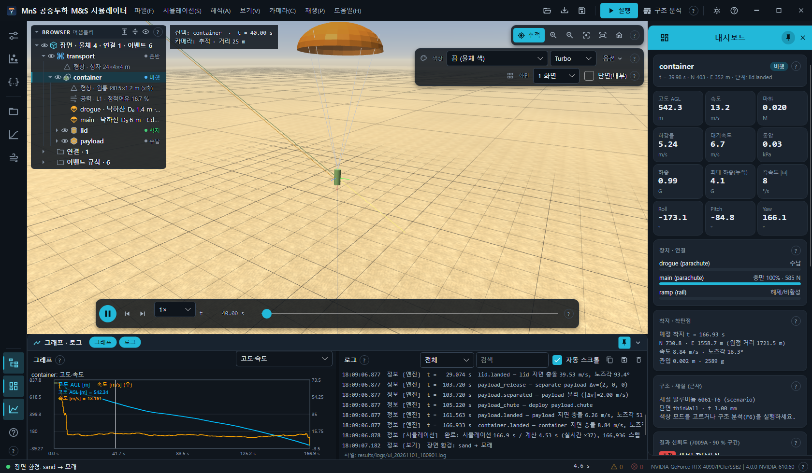
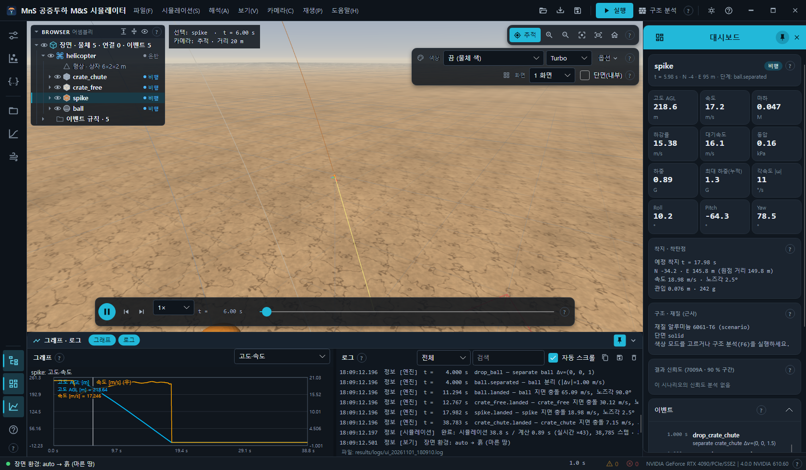
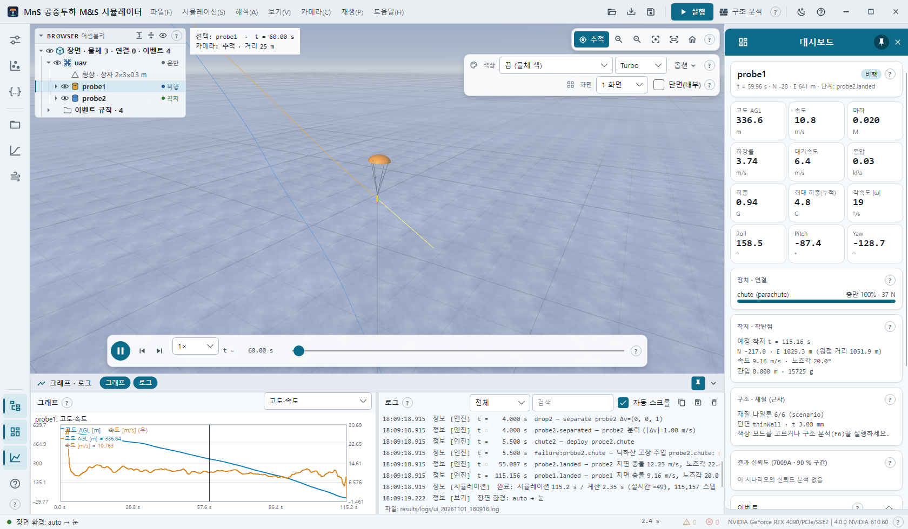

# 5. 장면 환경 (하늘 · 지면 · 조명)

보기 → **장면 환경** 은 하늘 돔 + 지면 텍스처 + 태양(방향광) + 하늘 · 땅 환경광을 한 벌로 바꿉니다. 해석 결과는 바뀌지 않고 3D 그림만 바뀝니다.

## 5.1 환경 목록 (내장 7종 + 자동)

| 메뉴 항목 | id | 모습 | 자동 선택 토양(`environment.soil`) |
| --- | --- | --- | --- |
| 기본 (분석) | `analysis` | 처음 값. 테마 단색 배경 + 격자 + 어두운 지면(하늘 · 그림자 · 안개 없음) | — |
| 자동 (시나리오 토양) | `auto` | 시나리오의 `environment.soil` 에 맞는 환경을 고름 | — |
| 풀밭 | `grass` | 풀밭 무늬 · 푸른 하늘 | `farmland` · `grass` · 그 밖 모두 |
| 흙 (마른 땅) | `dirt` | 흙 자국 · 갈라짐 | `clay` |
| 모래 | `sand` | 물결 무늬 | `sand` |
| 암반 | `rock` | 균열 | `rock` |
| 눈 | `snow` | 푸른 그늘 | `frozen` |
| 숲 가장자리 | `forest-edge` | 낙엽 · 지평선의 나무 실루엣 | — |

내장 환경의 하늘 · 지면은 코드로 만든 절차적 무늬라 외부 영상이 필요 없습니다. 공개 데모는 각각 모래(데모 1) · 흙(데모 2) · 눈(데모 3) 토양이라
**자동**을 고르면 데모마다 다른 환경이 됩니다.

## 5.2 장면 설정

| 메뉴 | 값 | 동작 |
| --- | --- | --- |
| 사용자 환경 불러오기… (environment.json · .hdr · .png) | 파일 | `environment.json`, 또는 정거원통 영상 한 장(`.hdr` · `.png` · `.jpg`)을 목록에 추가하고 선택. 영상이면 그 영상이 하늘 돔 · 환경광이 되고 가장 밝은 곳이 태양(그림자 방향). 다음 실행에도 다시 불러옴 |
| 밝기 | 50 · 75 · 100 · 125 · 150 · 200 % | 노출 배율 |
| 카메라 노출 (EV) | −2 · −1 · 0 · +1 · +2 EV | |
| 환경 회전 (태양 방위) | 0° ~ 315° (45° 간격) | 하늘 · 태양 · 나무 실루엣을 돌림 — 그림자 방향이 따라 바뀜 |
| 배경 | 환경 (하늘) · 단색 (테마 배경) | 단색이면 안개도 배경색으로 녹아듦 |
| 지면 표시 | 체크 | 텍스처 지면(시나리오 지면 고도). 크기 · 무늬 축척은 화면 범위에 맞춰 자동. 격자 레이어는 지면 위에 겹쳐 계속 보임 |
| 지면 평탄화 (지평선까지) | 체크 | 켬 = 지면이 지평선까지 / 끔 = 자동 축척 크기만, 그 밖은 하늘 돔 |
| 지면 반사 | 체크 | 스치는 각에서 지면에 하늘 색이 비침 |
| 지면 반사 거칠기 | 매끈 (0.1) · 보통 (0.5) · 거침 (0.9) | |
| 지면 높이 오프셋 | −1.0 · −0.5 · 0 · +0.5 · +1.0 m | 텍스처 지면 · 그림자 평면만 옮김(격자 · 착지 표식은 그대로) |
| 지면 그림자 | 체크 | 물체 · 캐노피 그림자를 태양 방향으로 지면에 투영 |
| 거리 안개 | 체크 | 멀수록 배경색으로 흐려짐 — 밀도는 화면 범위에 비례 |

고른 값은 `%APPDATA%\MnS.Simulator\settings.json` 의 `"scene"` 에 저장되어 다음 실행에 복원됩니다.

## 5.3 환경 파일 (`mns.environment/1`)

환경 하나는 `config/environments/<id>/environment.json` 한 파일입니다. 앱은 시작할 때 이 폴더를 모두 읽어 목록에 올리고,
잘못된 파일은 로그에 경로 · 필드와 함께 경고하고 건너뜁니다. 형식 전체는 [`config/environments/README.md`](../../config/environments/README.md).

주요 필드:

- `schema`(`mns.environment/1`) · `id`(영문 · 숫자 · `-` · `_`) · `displayName`(`ko` · `en`) · `style`(`scene` | `analysis`)
- `features` — `ground`(지면: 평면 또는 메시, 절차적 무늬 `procedural` 또는 영상) · `dome`(하늘 반구: 천정 · 지평선 · 안개 색, 나무 실루엣 여부)
- `ibl`(환경광 출처 · 노출) · `lights`(방향광 = 태양 색 · 세기 · 방향 · 그림자 색, 반구광 = 하늘 · 땅 색) · `ambient` · `background`
- `scaling`(자동 축척) · `centerAngleDeg`(기본 정면 각) · `soilMatch`(자동 선택에 쓰는 토양 이름 목록, `*` = 그 밖 모두)

새 환경을 만들려면 내장 환경 폴더 하나를 복사해 `id` 를 바꾸고 값을 고친 뒤 앱을 다시 시작하거나, 보기 → 장면 환경 → 사용자 환경 불러오기… 로 엽니다.

## 5.4 토양 자동 선택과 시나리오

시나리오의 `environment.soil` 은 착지 관입 · 충돌 판정에 쓰이는 토양 이름(예: `sand` · `clay` · `rock` · `frozen` · `farmland`)이며,
장면 환경 **자동**은 같은 이름을 각 환경 파일의 `soilMatch` 에서 찾아 그림을 고릅니다. 시나리오가 바뀌면 자동 환경도 따라 바뀝니다.

스모크 실행에서는 `--env <id|auto>` · `--env-file <파일>` 과 `--env-rot` · `--env-bright` · `--env-ev` · `--env-bg solid` · `--env-refl <거칠기>` ·
`--env-offset <m>` · `--env-off ground,shadows,fog,flatten` 으로 그 실행에만 적용합니다(설정 파일에 저장 안 함, [14장](14-headless-smoke.md)).
