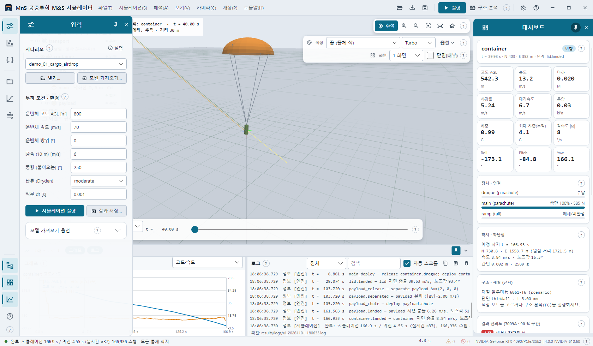
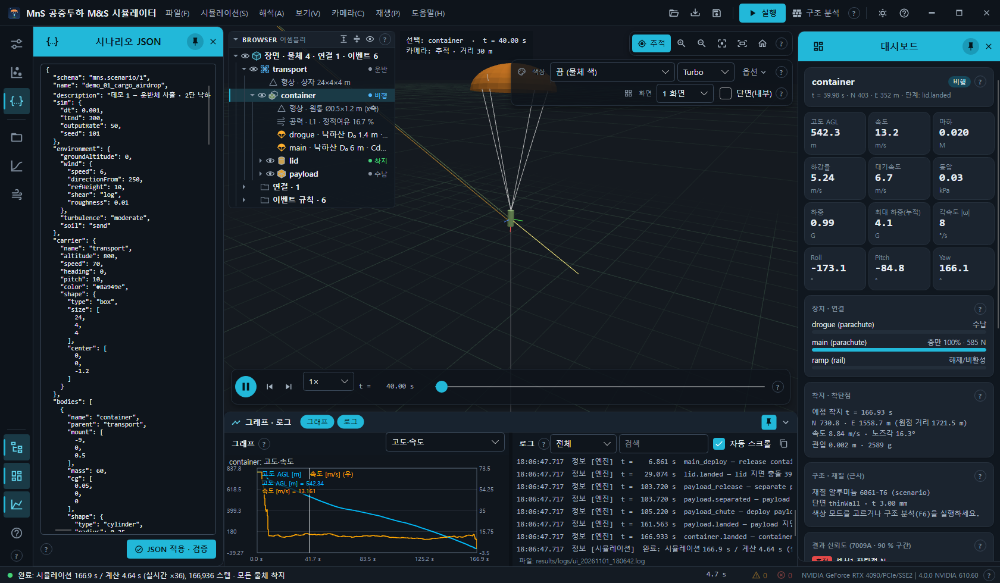
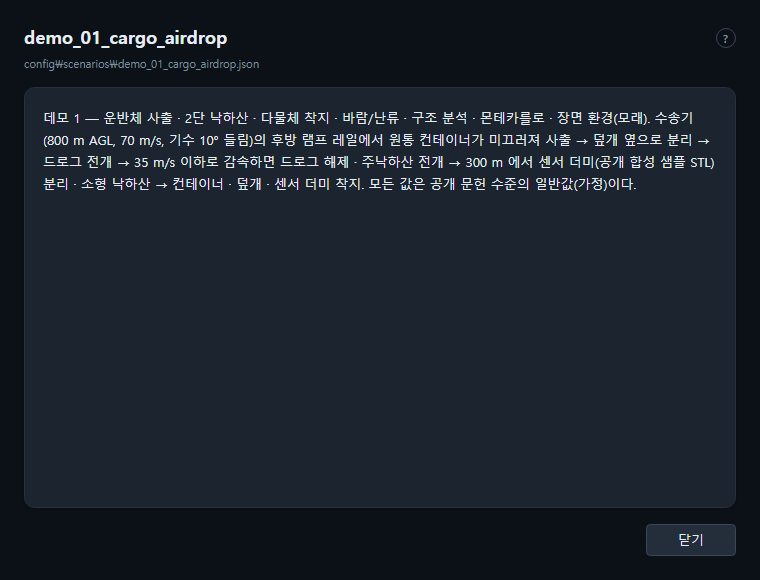
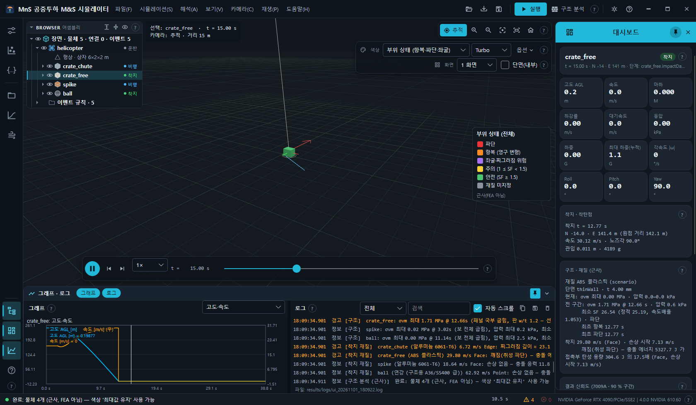
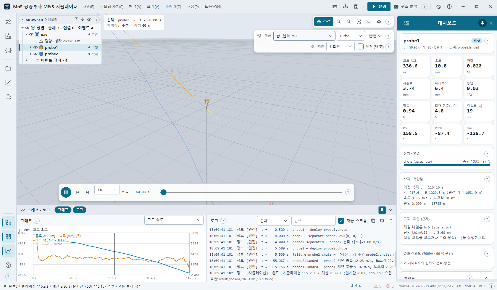

# 6. 시나리오 — 열기 · 조건 · JSON 편집 · 검증 · 설명 · 공개 데모

시나리오는 물체 · 운반체 · 환경 · 장치(낙하산 · 로터) · 연결 · 이벤트 · Monte Carlo 산포를 담은 JSON 한 파일(`schema: "mns.scenario/1"`)입니다.
형식 전체: [docs/scenario-schema.md](../scenario-schema.md).

## 6.1 열기

| 방법 | 동작 |
| --- | --- |
| 입력 서랍 → **시나리오** 목록 | `config/scenarios/*.json`(파일 이름순). 고르면 바로 불러옴 — 실행은 F5 |
| 파일 → 시나리오 열기… · 빠른 단추 열기 · 서랍 **열기…** · **Ctrl+O** | 다른 위치의 시나리오 JSON. 목록 밖 파일은 목록 끝에 추가되어 선택됨 |
| `.json` 파일을 창에 끌어다 놓기 | 같음(`*.massprops.json` 은 모델 가져오기) |

불러오면 로그에 `로드: <파일> — F5 로 실행` 이 나오고 입력 칸 · JSON 서랍 · 신뢰도 카드가 그 시나리오로 바뀝니다. 실패하면 오류와 함께 로그가 열립니다.

## 6.2 투하 조건 · 환경 (입력 서랍)

| 칸 | 시나리오 경로 | 단위 |
| --- | --- | --- |
| 운반체 고도 AGL [m] | `carrier.altitude` | m (지면 위) |
| 운반체 속도 [m/s] | `carrier.speed` | m/s |
| 운반체 방위 [°] | `carrier.heading` | ° |
| 풍속 (10 m) [m/s] | `environment.wind.speed` | m/s (10 m 높이) |
| 풍향 (불어오는) [°] | `environment.wind.directionFrom` | 바람이 불어오는 방향 ° |
| 난류 (Dryden) | `environment.turbulence` | `none` · `light` · `moderate` · `severe` |
| 적분 dt [s] | `sim.dt` | s (6DOF RK4 적분 간격) |

- 실행(F5 · MC)할 때 칸 값이 시나리오에 반영되고 JSON 서랍도 갱신됩니다. **빈 칸은 바꾸지 않습니다.**
- 운반체가 없는 시나리오에서는 운반체 칸을 무시합니다.
- 숫자가 아니면 실행 전에 `…: 숫자가 아님 '…'` 오류가 로그에 나옵니다.

같은 서랍의 **시뮬레이션 실행**(F5) · **결과 저장…**(Ctrl+S) 은 제목 표시줄 단추와 같고, 접힌 **모델 가져오기 옵션** 은 [10장](10-fusion-blender.md#101-fusion-모델-가져오기-ctrli).

## 6.3 시나리오 JSON 편집 · 적용 · 검증

레일의 **시나리오 JSON**(중괄호 아이콘) 서랍에 현재 시나리오 전체가 보입니다. 직접 고친 뒤 **JSON 적용 · 검증**(또는 시뮬레이션 → 시나리오 JSON 적용·검증)을 누르면
물체 · 연결 · 이벤트를 실제로 만들어 검증합니다.

- 성공: 로그 `검증 OK — 물체 n, 연결 n, 이벤트 n (F5 로 실행)`, 입력 칸이 새 값으로 갱신됩니다. 그다음 F5.
- 실패: 오류 문장이 로그(오류 배지)에 나오고 로그 섹션이 열립니다. 시나리오는 바뀌지 않습니다.
- 긴 JSON 은 서랍 핀을 켜고 오른쪽 가장자리를 끌어 넓히면 편합니다.

명령줄에서는 `mns validate <scenario.json>` 이 같은 검증과 물체별 질량 · CG · 공력 · 장치 목록을 출력합니다([12장](12-cli.md)).

## 6.4 시나리오 설명

입력 서랍의 **설명** 단추 또는 도움말 → **현재 시나리오 설명…** 은 시나리오의 `description` 원문을 별도 창으로 보여 줍니다(파일 경로 포함, Esc 로 닫기).
가져오기 · 결과에서 만든 시나리오는 `(파일 없음 …)` 으로 표시됩니다.

## 6.5 공개 데모 시나리오 3종

`config/scenarios/demo_*.json` — 모든 값은 공개 문헌 수준의 일반값(가정)입니다.

### demo_01_cargo_airdrop — 운반체 사출 · 2단 낙하산 · 다물체 착지

수송기(`transport`, 800 m AGL · 70 m/s · 기수 10° 들림)의 후방 램프 레일에서 원통 컨테이너(`container`)가 미끄러져 사출 → 덮개(`lid`) 분리 →
드로그 전개 → 35 m/s 이하로 감속하면 드로그 해제 · 주낙하산 전개 → 300 m 에서 센서 더미(`payload`, 공개 합성 샘플 STL) 분리 · 소형 낙하산 → 세 물체 착지.

- 바람 6 m/s(250°에서) · 난류 `moderate` · 토양 `sand`(장면 환경 자동 = 모래)
- 이벤트: `ramp_open` → `lid_off` → `drogue_deploy` → `main_deploy` → `payload_release` → `payload_chute`
- 지표: 개방 하중 · 착지 간격 · 덮개와 주낙하산 근접(잔해 간섭)
- Monte Carlo: 6DOF 100회(`container` 기준), 산포 5개(풍속 · 풍향 · 주낙하산 Cd · 컨테이너 질량 · 드로그 지연)
- 해 보기: 구조 분석(F6), 단면(내부)으로 컨테이너 안의 센서 더미 보기, 충격 가속도 색 + Ctrl+] 로 낙하산 개방 충격 슬로모션

### demo_02_impact_materials — 착지 충돌 재질 판정 · 개방 충격 · 관입

헬기(`helicopter`, 250 m AGL · 20 m/s)에서 화물 4개를 1초 간격으로 투하합니다.

| 물체 | 재질 · 단면 | 특징 |
| --- | --- | --- |
| `crate_chute` | 알루미늄 6061-T6 · 얇은 벽 | 1단 리핑 낙하산 → 개방 충격 완화 |
| `crate_free` | ABS · 얇은 벽 | 낙하산 없음 → 착지 충돌 판정(손상 없음 · 찌그러짐 · 깨짐) |
| `spike` | 알루미늄 6061-T6 · 솔리드 | 공개 합성 샘플 스파이크 STL, 기수 선행 관입 |
| `ball` | 연강 · 솔리드 | 속이 찬 단면 비교 |

- 바람 3 m/s · 난류 `light` · 토양 `clay`(자동 = 흙)
- 구조 분석(F6)이 물체별 응력 · 안전율과 착지 손상을 냅니다. CalculiX FEA(F7)는 솔리드 `spike` · `ball` 이나 얇은 벽 상자(셸)에 써 볼 수 있습니다.
- Monte Carlo: 6DOF 100회(`crate_chute` 기준), 산포 5개(리핑 비율 포함)

### demo_03_wind_dispersion — 고도별 바람 · 강한 난류 · 낙하산 고장 · 착지 분산

소형 고정익 무인기(`uav`, 600 m AGL · 25 m/s)에서 원통형 센서 더미 `probe1` · `probe2` 를 3초 간격으로 투하 → 각자 낙하산 전개 → 바람에 밀려 착지.
`probe2` 의 낙하산에는 확률 고장(부분 충만 50 %, 확률 20 %)이 들어 있습니다.

- 고도별 바람 표(0 ~ 1,000 m) · 난류 `severe` · 표준 대기보다 기온 −15 °C(`temperatureOffset`) · 토양 `frozen`(자동 = 눈)
- Monte Carlo: 6DOF 100회(`probe1` 기준, 산포 7개) **와 GPU 단순 모델 10만 회**(`gpuMonteCarlo` 절) — 세 데모 가운데 GPU MC 를 쓸 수 있는 유일한 데모
- 지표: 두 물체 착지 간격(목표 100 m) · 최대 하중

