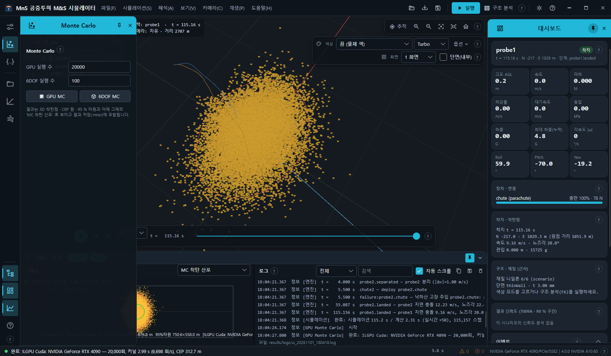
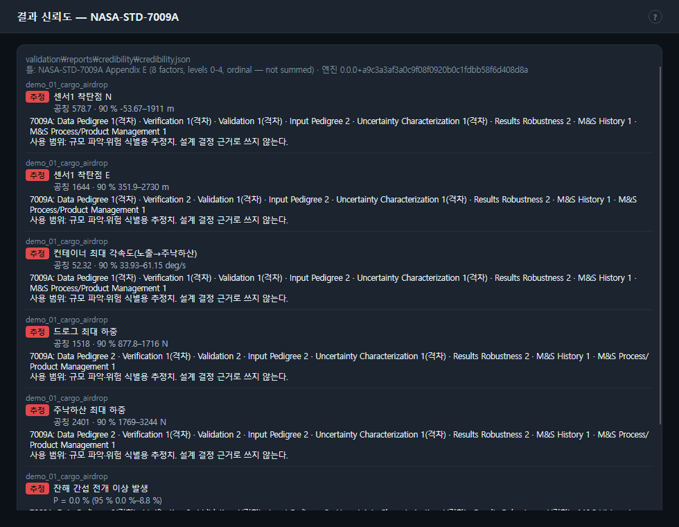

# 7. Monte Carlo · 분산 · 결과 신뢰도

## 7.1 Monte Carlo 두 가지

레일의 **Monte Carlo** 서랍 또는 시뮬레이션 메뉴에서 실행합니다.



| | GPU MC (단순 모델) | 6DOF MC (CPU, 전체 6DOF) |
| --- | --- | --- |
| 메뉴 · 단추 | 시뮬레이션 → GPU Monte Carlo (단순 모델) · 서랍 **GPU MC** | 시뮬레이션 → CPU Monte Carlo (전체 6DOF) · 서랍 **6DOF MC** |
| 실행 수 칸 | **GPU 실행 수** (기본 100000) | **6DOF 실행 수** (기본 100) |
| 모델 | 시나리오의 `gpuMonteCarlo` 절(3DOF 질점 + 낙하산 단순 모델) | 시나리오 전체를 매번 6DOF 로 다시 실행 |
| 표본 | LHS(라틴 하이퍼큐브), 시드 7 | LHS, `monteCarlo.impactBody`(없으면 선택 물체) 기준 |
| 산포 | `gpuMonteCarlo` 안의 산포 | 시나리오 `dispersions` |
| 가속 | ILGPU(GPU). GPU 가 없으면 CPU 로 대체하고 로그에 알림 | CPU 다중 스레드(진행 `n/N 실행`) |
| 취소 | 안 됨 | **Esc** |
| 끝 로그 | 백엔드 · 실행 수 · 커널 시간(회/s) · CEP | 실행 수 · 시간 · 실패 수 · CEP |

- `gpuMonteCarlo` 절이 없는 시나리오에서 GPU MC 를 누르면 `이 시나리오에는 gpuMonteCarlo(단순 모델) 절이 없습니다 → CPU 6DOF MC 를 쓰세요.` 경고만 나옵니다.
  공개 데모 가운데 GPU MC 가 있는 것은 `demo_03_wind_dispersion` 입니다.
- 6DOF MC 는 `monteCarlo.impactBody` 나 선택 물체가 없으면 실행하지 않습니다. 실패한 실행(오류 · 미착지)은 로그에 최대 20개까지 경고합니다.
- 실행 전 입력 서랍의 조건 칸이 시나리오에 반영됩니다.

## 7.2 결과 보기

- 3D: **MC 착탄점**(착지 점들) · **MC CEP 원 · 95% 타원** 레이어. 결과가 나오면 두 레이어를 자동으로 켜고 산포가 보이게 카메라를 맞춥니다.
- 그래프: 자동으로 **MC 착탄 산포**(CEP 원 초록 · 95 % 타원 빨강)로 바뀌고, 꺼져 있으면 그래프 섹션을 엽니다.
- 결과 저장(.mnsr)에 MC 결과가 함께 들어가고, 불러오면 그대로 다시 보입니다.
- CEP(50 % 원 반지름)는 끝 로그와 그래프에 나옵니다.

명령줄: `mns mc <scenario.json> --runs N [--body NAME] [--seed S] [--sampling lhs|random] [--out DIR]` → `mc_runs.csv` · `mc_summary.json`,
`mns gpumc <scenario.json> [--runs N] [--cpu] [--seed S] [--out DIR]` → `gpumc_runs.csv` · `gpumc_summary.json`([12장](12-cli.md)).

### 분산 (`dispersions`)

시나리오의 `dispersions` 배열 각 항목은 바꿀 값의 JSON 경로(`path`)와 분포(`dist`: `normal` · `truncnormal` · `uniform` 등, `sd` · `min` · `max` …)입니다.
예: 풍속 · 풍향 · 낙하산 Cd · 질량 · 전개 지연. Monte Carlo 는 실행마다 이 값들을 표본으로 뽑아 시나리오에 넣고 돌립니다. 형식: [scenario-schema.md](../scenario-schema.md).

## 7.3 결과 신뢰도 (NASA-STD-7009A)

결과 신뢰도는 `mns credibility` 가 만든 `validation/reports/credibility/credibility.json` 을 읽어 보여 줍니다(앱은 계산하지 않음).

```text
mns credibility <scenario.json> [<scenario.json> …] [--runs N] [--out validation/reports/credibility] [--raw DIR]
```

- 입력 출처 등급 · 불확도 정량화(출처 등급 분포 MC + dt/2 수치 오차 + 공개 검증 모델 형태 오차, PRCC 민감도) · NASA-STD-7009A 8요인 채점 →
  결과별 **신뢰 / 참고 / 추정** 등급과 **90 % 구간**, 시험 우선순위.
- 앱은 시나리오 폴더 · 현재 폴더 · 실행 파일 폴더에서 위로 올라가며 `validation/reports/credibility/credibility.json` 을 찾습니다.
- 시나리오에 `uq` 절(`profile` · `runs` · `seed` · 대상 물체 · 낙하산)이 있어야 합니다. 공개 데모 1 에 예가 있습니다:
  `mns credibility config/scenarios/demo_01_cargo_airdrop.json`(MC 40회, 1분 안팎).

### 대시보드 카드 — 결과 신뢰도 (7009A · 90 % 구간)

현재 시나리오의 출력마다 등급 배지(신뢰 녹색 · 참고 황색 · 추정 적색) · 이름 · `공칭 … · 90 % … – …` (확률 출력은 `P = … (95 % … – …)`).
파일이 없으면 "신뢰도 분석 없음 (mns credibility)", 이 시나리오 항목이 없으면 `이 시나리오의 신뢰도 분석 없음`.

### 해석 → 결과 신뢰도 — 7009A 요인 · 신뢰 등급 · 시험 우선순위…

출력마다 시나리오 · 배지 · 구간과 7009A 8요인 수준(기준 미달은 `(격차)`) · 사용 범위, 끝에 **시험 우선순위**(신뢰도를 올리는 순서, 점수)를 보여 주는 창입니다.


