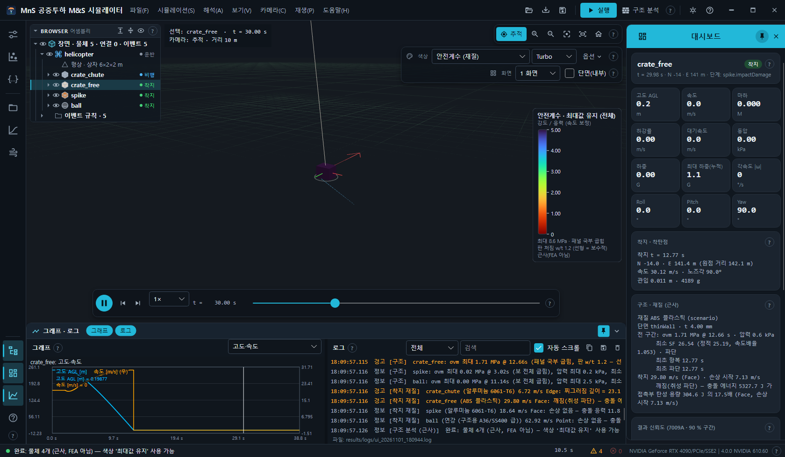
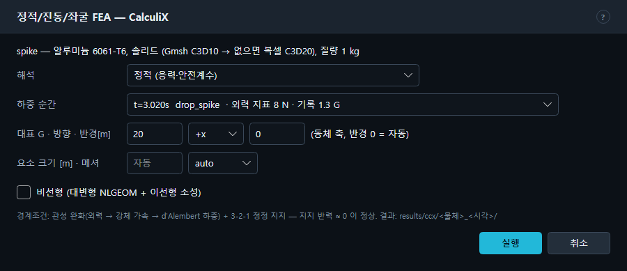
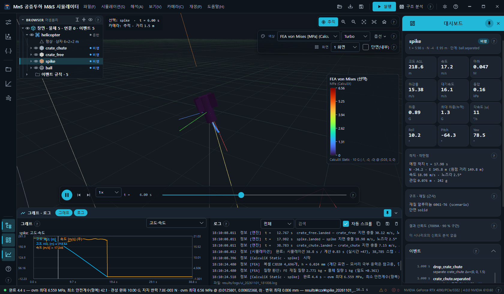
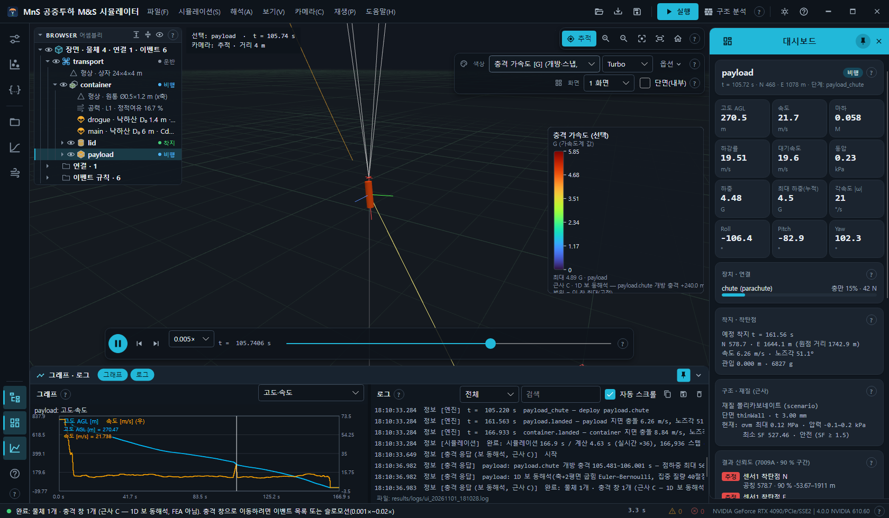
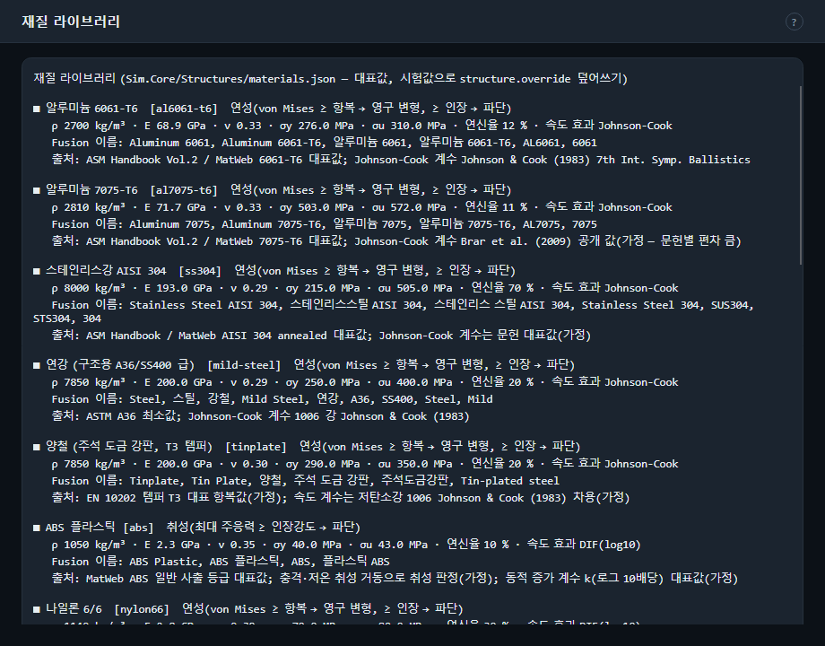

# 8. 구조 · 충격 · FEA · 재질 · 진동 피로

해석 메뉴(또는 레일의 **해석** 묶음)의 구조 기능은 정확도와 비용이 다른 여러 단계로 나뉩니다.

| 단계 | 기능 | 등급 · 성격 | 외부 프로그램 |
| --- | --- | --- | --- |
| 근사 | 구조 분석 (F6) · 표면 압력 · 근사 응력 · 안전계수 · 부위 상태 색 | 근사(FEA 아님), 재생 시각마다 | 없음 |
| 근사 동해석 | 개방 충격 응답(보 동해석) · 충격 가속도/응력 색 | 근사 C — 1D 보 | 없음 |
| FEA | 정적/진동/좌굴 (F7) | 선형(선택: 비선형) FEA | CalculiX (+ 선택 Gmsh) |
| FEA 과도 | 개방 충격 과도 응답 | 등급 B — 모달 과도 | CalculiX |
| 충돌 FEA | 착지 충돌 셸 해석 | 명시적 충돌 | OpenCourant |

재질이 지정된 물체(`structure.material` 또는 Fusion 재질)만 안전계수 · 항복 · 파단 판정을 받습니다.

## 8.1 구조 분석 — 전 구간 최대값 · 최초 항복/파단 (근사) — F6

- 제목 표시줄 **구조 분석** · 해석 메뉴 · **F6**. 결과가 있어야 합니다(먼저 F5). Esc 로 취소.
- 모든 물체를 전 구간(물체마다 프레임 표본)에서 평가해 **최대 von Mises 응력과 그 시각 · 최대 압력 · 최소 안전계수(정적 · 속도 배율) · 최악 상태**를 냅니다.
- 재질이 있는 물체는 **최초 항복 · 최초 파단 · 좌굴 위험 · 착지 손상** 이벤트를 이벤트 목록에 더합니다(이름 끝 `.yield` · `.fracture` · `.buckling` · `.impactDamage`).
- 로그(출처 `구조`): `<물체>: σvm 최대 … MPa @ … s (지배 성분), 압력 최대 … kPa, 최소 SF …, 상태 …` — 판 처짐이 크면 `판 w/t … — 선형 판 응력은 보수적`.
- 착지 충돌 재질 판정(출처 `착지 재질`): `<물체> (<재질>) … m/s <접촉>: <판정> — <방법>` (예: 손상 없음 · 찌그러짐 · 깨짐).
- 끝나면 색 모드가 꺼져 있었으면 **근사 응력**으로 켜고, 색상 옵션 **최대값 유지 (전 구간)** 를 쓸 수 있게 됩니다. 결과 요약에 `structural` 이 추가됩니다.
- 대시보드 **구조 · 재질 (근사)** 카드: `전 구간: σvm … MPa @ … s · 압력 … kPa`, `최소 SF … (정적 …, 속도배율 …)`, 최초 항복/파단/좌굴 시각, `착지 … m/s (…) · 손상 시작 … m/s` 와 판정.

명령줄: `mns run <scenario.json> --structural` → `structural.json` · 이벤트 추가([12장](12-cli.md)).

## 8.2 FEA 하중 케이스 내보내기…

폴더를 고르면 `loadcases_<날짜_시각>/` 에 `loadcases.json` + 면별 CSV 를 씁니다(외부 FEA 입력용). 명령줄: `mns run … --loadcases`.

## 8.3 정적/진동/좌굴 FEA — CalculiX (선택 물체)… — F7

선택한 물체(운반체가 아니고 재질이 있는 물체)를 CalculiX 로 해석합니다. 옵션 창이 먼저 뜹니다.

| 칸 | 값 |
| --- | --- |
| 머리 | `<물체> — <재질>, 얇은 벽 S6 셸 (t … mm, 표시 면 1:1)` 또는 `솔리드 (Gmsh C3D10 → 없으면 복셀 C3D20)`, 질량 |
| 해석 | `정적 (응력·안전계수)` · `고유진동 (자유-자유 모드)` · `좌굴 (하중 계수)` |
| 하중 순간 | 비행 중 연결점 하중이 큰 순간 최대 16개(`t=…s <이름> · 외력 지표 … N · 기록 … G`, 기본 = 가장 심한 순간) 또는 `대표 G 하중 (아래 G · 방향)` |
| 대표 G · 방향 · 반경[m] | 대표 G 하중일 때: G(기본 20) · 방향 `-x` `+x` `-y` `+y` `-z` `+z`(동체 축) · 하중 반경(0 = 자동) |
| 요소 크기 [m] · 메셔 | 비우면 자동 · `auto` · `gmsh` · `voxel` |
| 비선형 (대변형 NLGEOM + 이선형 소성) | 체크 |

- 경계조건: **관성 완화**(외력 → 강체 가속 → d'Alembert 하중) + 3-2-1 정정 지지 — 지지 반력 ≈ 0 이 정상입니다.
- 결과 폴더: `results/ccx/<물체>_<날짜_시각>/`. 고유진동 해석은 하중 순간이 필요 없습니다.
- 끝나면 정적은 색상 **FEA von Mises [MPa] (CalculiX)**, 진동 · 좌굴은 **FEA 변위·모드 형상 [mm] (CalculiX)** 로 바뀌고 변형 형상을 그립니다.
  로그: `완료 … s — <판정> · 관성 완화 … G, 지지 반력 … N · σvm 최대 … MPa @ … · 변위 최대 … mm — <폴더>`. 최소 SF < 1 이거나 좌굴 계수 < 1 이면 경고.
- CalculiX 가 없으면 `… — CCX_PATH 를 지정하세요.` 오류. 재질이 없으면 해석하지 않습니다.
- 결과는 결과 저장(.mnsr)의 `fea.json` 에 들어가 불러오면 다시 보입니다.

### FEA 변형 표시 배율

`끔 (원래 형상)` · `자동 (최대 변위 = 크기의 5%)`(기본) · `×1 (실제)` · `×10` · `×100` · `×1000`. 정적 = 실제 변위 × 배율, 진동 · 좌굴 = 정규화 모드 형상.

### CalculiX · Gmsh 설치 확인

로그에 CalculiX 실행 파일 위치, Gmsh 메시 도구(`없음(복셀 대체 사용)` 또는 경로), 쓰는 파이썬(`MNS_PYTHON` 또는 PATH 의 python)을 표시합니다.
CalculiX 위치: 환경 변수 `CCX_PATH`(실행 파일 또는 폴더) → 기본 `C:\tools\CalculiX\calculix_2.23_4win`.

명령줄: `mns ccx <result.mnsr|scenario.json> --body NAME …`(수렴 시험 `--converge`, CAD 메시 `--cad PART.step` 포함), `mns ccx-verify`, `mns ccx-mesh`([12장](12-cli.md)).

## 8.4 개방 충격 응답 — 보 동해석 (근사 C, 충격 가속도·응력 색)

드로그 · 주낙하산 개방, 테더 스냅처럼 연결점 하중이 급히 오르는 **충격 창**마다 1D 보 동해석(축 + 굽힘 보, Newmark 적분, 실린 물체 질량 포함)을 한 번 계산하고,
재생 시각마다 면 값을 다시 냅니다.

- 메뉴를 누르면 색상이 **충격 가속도 [G] (개방·스냅, 동해석)** 로 바뀌고(이미 충격 모드면 다시 칠함) 배경에서 계산합니다(취소 가능).
  색상에서 **충격 응력 von Mises [MPa] (동해석)** 도 고를 수 있습니다.
- 로그: 창마다 `<물체>: <창 이름> t0–t1 s — 점하중 최대 … N, 면 가속도 최대 … G, 충격 응력 최대 … MPa`.
- 창 안에서는 레전드 범위를 창 최대로 고정 → 충격이 하중점에서 퍼지고 울리다 줄어드는 모습이 보입니다. 창 밖은 준정적(관성 완화).
- 실려 있는(수납) 물체는 운반 물체의 보 가속도를 그 위치에서 받아 **충격 가속도**만 표시합니다(마운트 동특성 없음).

## 8.5 다음 / 이전 충격 창으로 이동 — Ctrl+] / Ctrl+[

충격 창 시작(촉발 시각 10 ms 전)으로 이동하고, 재생 속도가 0.02× 보다 빠르면 **0.005× 슬로모션**으로 바꿉니다(1 ms 를 0.2초에).
충격 창이 아직 없으면 `충격 창이 없습니다 — 색상을 '충격 가속도/응력'으로 바꾸면 계산합니다.` 경고.

## 8.6 개방 충격 과도 응답 — CalculiX 모달 과도

선택 물체(실려 있으면 그것을 싣고 있는 물체)의 **현재 또는 다음 충격 창**을 CalculiX 모달 과도 응답(탄성 모드 12개, 시간 영역 관성 완화)으로 풉니다.

- 조건: 재질 있음 · **솔리드 단면만**(얇은 벽 셸은 셸 모달 과도가 가짜 응력을 내므로 막혀 있음 — 보 동해석 사용) · FE 요소 40,000개 이하 · CalculiX 설치.
- 결과: `results/ccx/<물체>_shock_<날짜_시각>/`, 색상 **FEA 충격 응력 [MPa] (CalculiX 과도)**, 레전드 각주 `등급 B · CalculiX 모달 과도(n모드, ζ …) · <창> ±… ms`.
  결과 구간 밖이면 최대 시각으로 이동합니다. 보 동해석 결과가 있으면 같은 창의 최대와 비교한 비를 로그에 남깁니다.

## 8.7 충돌 FEA — OpenCourant 착지 충돌 해석 (선택 물체)…

선택 물체의 착지 순간(속도 · 지면 법선)으로 셸 충돌 덱을 쓰고 OpenCourant(Radioss) `starter → engine → anim_to_vtk` 를 외부 프로세스로 실행합니다(최대 30분, 취소 가능).

- 덱 · 결과: `results/fea/<물체>_<날짜_시각>/` (`mns_fea_console.log`).
- 끝나면 색상 **FEA 소성변형률 (OpenCourant)** 와 판정. 항복 이상이면 경고.
- OpenCourant 가 없으면 덱만 쓰고 오류로 알립니다. 위치: `OPENCOURANT_PATH` → 기본 `C:\tools\OpenCourant`.
- **OpenCourant 설치 확인**: 루트 · starter · engine · anim_to_vtk 유무를 로그에.

명령줄: `mns fea <result.mnsr|scenario.json> --body NAME [--deck-only] …`, 검증 `mns fea-taylor`([12장](12-cli.md)).

## 8.8 재질 라이브러리 보기

재질마다 이름 · 키 · 취성/연성 판정 규칙(취성: 최대 주응력 ≥ 인장강도 → 파단 / 연성: von Mises ≥ 항복 → 영구 변형, ≥ 인장 → 파단) ·
ρ · E · ν · σy · σu · 연신율 · 속도 효과 모델 · Fusion 재질 이름(자동 매칭) · 출처를 보여 줍니다. 원본: `src/Sim.Core/Structures/materials.json`(대표값).

| 키 | 이름 | 키 | 이름 |
| --- | --- | --- | --- |
| `al6061-t6` | 알루미늄 6061-T6 | `pla` | PLA |
| `al7075-t6` | 알루미늄 7075-T6 | `cfrp-qi` | CFRP (준등방 적층 대표값) |
| `ss304` | 스테인리스강 AISI 304 | `gfrp-qi` | GFRP (E-glass/에폭시 준등방 적층 대표값) |
| `mild-steel` | 연강 (구조용 A36/SS400 급) | `ti6al4v` | 티타늄 Ti-6Al-4V (어닐링) |
| `tinplate` | 양철 (주석 도금 강판, T3 템퍼) | `steel-4130` | 합금강 AISI 4130 (노멀라이즈) |
| `abs` | ABS 플라스틱 | `17-4ph-h1150` | 석출경화 스테인리스 17-4PH (H1150, 보수) |
| `nylon66` | 나일론 6/6 | `17-4ph-h1025` | 석출경화 스테인리스 17-4PH (H1025) |
| `pc` | 폴리카보네이트 | `iglidur-j` | iglidur J (미끄럼 패드 — 허용 면압) |
| `epp` | EPP 폼 | `eva` | EVA 폼 |

재질 지정: 시나리오 물체의 `structure.material`(키), 시험값은 `structure.override` 로 덮어쓰기, 또는 Fusion 에서 가져온 모델의 재질 이름 자동 매칭.
Fusion 내보내기 1.1 이 재료 물성(E · 항복/극한 강도 등)을 넣었으면 그 값을 별칭 표보다 먼저 씁니다 — 대시보드에 `(Fusion 재료 물성)` 으로 표시([10장](10-fusion-blender.md)).
명령줄: `mns materials`.

## 8.9 진동 피로 (근사)

Fusion 해석 패키지를 CalculiX 로 재현하며 고유진동수까지 구한 결과(`mns simpkg … --run --modal` 의 `summary.json`, [10장](10-fusion-blender.md#103-fusion-해석-패키지-simpkg))를
`mns tumble-study … --fatigue-simpkg <summary.json>` 에 주면 보고서에 **진동 피로(근사)** 절이 생깁니다.

1. 자유 비행 구간의 대기속도 범위에서 와류 흘림 주파수 `f_s = St · V / D`(St 0.20 ~ 0.256)를 구합니다.
2. 구조 고유진동수 `f_n` 과 비교해 공진 여유를 판정합니다: `공진 통과(속도 범위 안에서 f_s = f_n)` · `여유(f_s < 0.8 f_n)` · `근접(0.8 f_n ≤ f_s < f_n)` · `f_s > f_n 전 구간(공진 위)`.
3. 양력 변동 계수(C'L rms 0.05 ~ 0.3) · 최대 동압으로 가속도 진폭을, 감쇠비 0.02 로 증폭을 구해 정적 해석의 99 % 응력에 비례시켜 응력 진폭을 얻습니다.
4. 노출 시간 동안의 반복 수와 공개 S-N 곡선(6061-T6 · 7075-T6, 그 밖의 재질은 손상 계산 안 함)으로 **Miner 손상 D** 를 냅니다.

**판정이 아니라 크기 가늠**입니다 — D ≪ 1 이면 무시 가능, D ~ 0.1 이상이면 진동 시험 · 비정상 CFD 가 필요합니다. 고유진동 입력이 없으면 그 절은
`구조 고유진동수 입력 없음(...) — 공진 여유 · 손상은 계산하지 않음.` 으로 나옵니다. `mns loads` 보고서에도 셸 1차 고유진동수 대비 공진 여유 문단이 들어갑니다.
