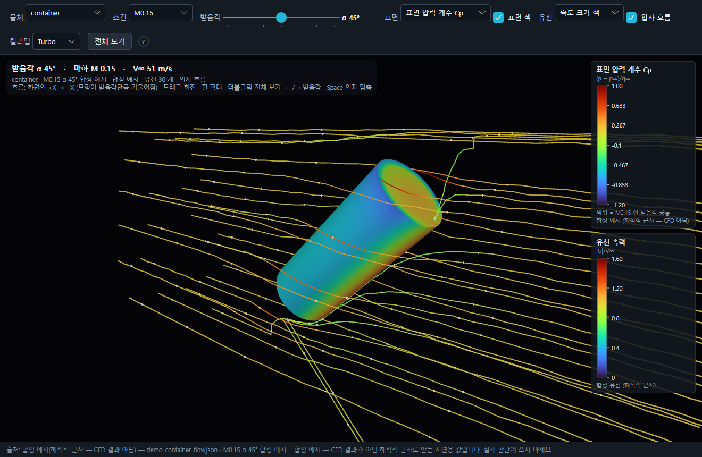
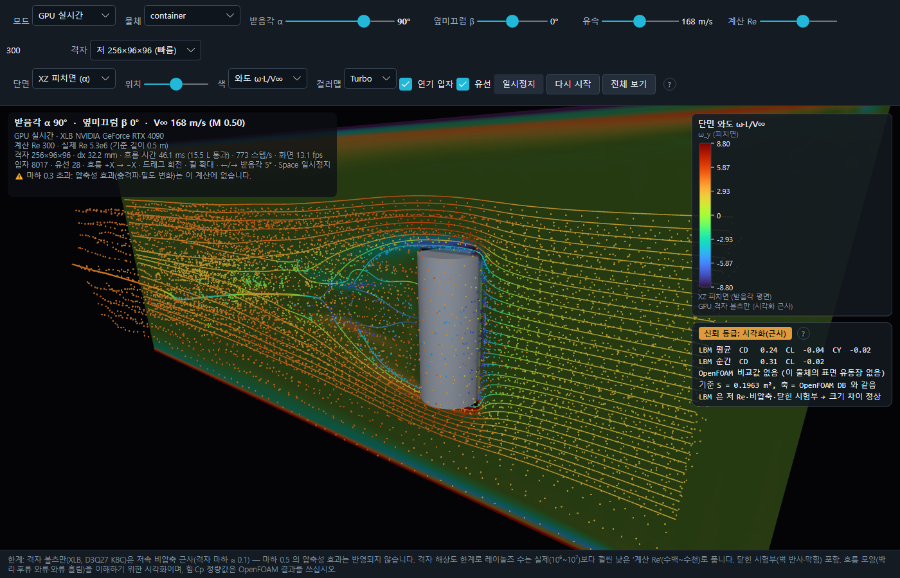

# 9. 유동 — 풍동 보기 · GPU 가상 풍동 · OpenFOAM 결과 · 유동 영역 규칙

두 창 모두 **흐름 모양을 이해하는 시각화**입니다. 시뮬레이션의 공력 계산 값이 아니며, 창 아래에 출처와 한계가 늘 표시됩니다.
무대(3D 영역)는 흐름 색이 잘 보이도록 두 테마 모두 어두운 바탕이고, 막대 · HUD · 바닥줄은 테마를 따릅니다.

## 9.1 풍동 보기 — CFD 표면 압력 · 3-D 유선 · 입자 흐름 (선택 물체)… — F8

미리 계산한 OpenFOAM 정상 RANS 결과(CFD 표면 유동장, schema `mns.surface-flow/1`)를 풍동 장면으로 보여 줍니다.

- 대상: 시나리오에서 `aero.flowField` 가 지정된 물체(선택 물체 우선). 그런 물체가 없으면 기본 유동장(`config/aero_db/*_flow.json` 가운데 이름순 첫 파일 — 있을 때만)과 원통 외형으로 엽니다.
  둘 다 없으면 `aero.flowField 가 있는 물체도, 기본 유동장 파일(…)도 없습니다.` 경고.
- 처음 받음각 = 선택 물체의 현재 대기상대 받음각에 가장 가까운 케이스. 이미 열려 있으면 닫고 새로 엽니다.
- 공개 데모 1 의 컨테이너에는 시연용 **합성 예시** 유동장 `samples/flow/demo_container_flow.json` 이 지정돼 있습니다
  (`tools/samples/make_public_flowfield.py` — 아임계 원기둥 Cp 와 2-D 퍼텐셜 유선으로 만든 해석적 근사, CFD 결과 아님).
  이 파일을 열면 창 아래 출처가 `합성 예시(해석적 근사 — CFD 결과 아님)` 로 표시됩니다.



| 막대 항목 | 동작 |
| --- | --- |
| 물체 | 유동장이 있는 물체 |
| 조건 | 조건 묶음(마하 · 해석 종류) — 받음각 케이스가 많은 묶음이 먼저 |
| 받음각 슬라이더 · ← → (또는 , .) | 계산된 받음각 케이스 사이를 이동. HUD 에 받음각 · 마하 · 자유류 속도 |
| 표면 | `표면 압력 계수 Cp` (p − p∞)/q∞ · `표면 속도비 \|Uₑ\|/V∞` (Cp 에서 등엔트로피 환산, 경계층 바깥 근사) · `벽 마찰 계수 Cf` \|τ_w\|/q∞ |
| 표면 색 | 끄면 회색 물체(유선만) |
| 유선 | `속도 크기 색`(\|U\|/V∞, 둘째 레전드 '유선 속력') · `단색 노랑` · `끔` |
| 입자 흐름 · Space | 유선을 따라 흐르는 입자(빠른 곳일수록 간격이 벌어짐) — Space 로 멈춤/다시 |
| 컬러맵 | Turbo · Viridis (표면 · 유선 공통) |
| 전체 보기 · F | 시점 초기화 |
| 드래그 · 휠 · Esc | 궤도 회전(Ctrl+드래그 = 시점 회전, 오른쪽 드래그 = 이동) · 커서 위치 확대 · 창 닫기 |

표면 값은 정점마다 표본화해 GPU 가 보간하고, 색 범위는 같은 조건 묶음의 모든 받음각에 공통입니다. 흐름은 화면의 +X → −X 이며 모형이 받음각만큼 기울어집니다.

한계(창 아래): 정상 RANS(k-ω SST) 결과로, 원통 기준 실험 대비 항력을 30~60 % 과소 예측했습니다. 정성 시각화입니다.

### 재생 장면에 겹쳐 보기

보기 → 3D 표시 레이어 → **선택 물체 CFD 유선 (가장 가까운 받음각 · aero.flowField)** 을 켜면 재생 중인 3D 장면에서 선택 물체 주위에
현재 자세에 가장 가까운 케이스의 유선을 그립니다(처음엔 꺼짐). 색상 **CFD 표면 압력 계수 Cp (OpenFOAM)** 는 현재 자세의 표면 Cp 를 면 색으로 보여 줍니다([4장](04-3d-view-camera-playback.md#44-색상-모드--레전드)).

## 9.2 GPU 가상 풍동 — 실시간 흐름 (XLB 격자 볼츠만 · 연기 · 와류 · 시각화 근사)… — Shift+F8

물체를 가상 풍동에 놓고 받음각 · 옆미끄럼 · 유속 · 계산 Re 를 바꾸면, 외부 오픈소스 솔버 **XLB**(격자 볼츠만 D3Q27, NVIDIA Warp CUDA)가
별도 파이썬 프로세스(`tools/airflow/server.py`)에서 그 자리에서 흐름을 계산하고 앱은 로컬 TCP 로 단면 장 · 연기 입자 · 유선을 받아 그립니다.
받음각을 바꾸면 같은 격자에서 물체만 다시 복셀화해 흐름이 이어서 바뀌고, 박리 · 후류 와류 · 와류 흘림이 시간에 따라 움직입니다.



### 설치 (처음 한 번, 저장소 또는 설치 폴더 루트)

```powershell
python -m venv tools/airflow/.venv
$env:PYTHONUTF8=1; tools/airflow/.venv/Scripts/pip.exe install -r tools/airflow/requirements.txt
```

NVIDIA GPU · 드라이버가 필요합니다. 한국어 Windows 에서는 `PYTHONUTF8=1` 이 필요합니다(요구 파일의 한국어 주석). 다른 파이썬은 환경 변수 `MNS_AIRFLOW_PYTHON`.

### 대상 물체

메시가 있는 물체(표면 유동장이 있는 물체 → 선택 물체 순으로 앞). 장면이 없으면(시나리오 실행 전) 실모델 STL 또는 유동장 원통 외형을 씁니다.
놓을 메시가 하나도 없으면 `가상 풍동에 놓을 물체 메시가 없습니다(시나리오를 실행하거나 모델을 가져오세요).` 경고. 처음 받음각 = 선택 물체 현재 받음각(없으면 45°).

### 막대 항목

| 항목 | 값 · 동작 |
| --- | --- |
| 모드 | `GPU 실시간` · `OpenFOAM 재생`(미리 계산한 비정상 해석 시퀀스를 같은 그리기로 재생 — 자료가 없으면 `(자료 없음)`) · 재생 시퀀스 콤보 |
| 물체 | 위 대상 목록 |
| 받음각 α · ← → | −180 ~ 180°, 키 한 번 = 5° |
| 옆미끄럼 β | −45 ~ 45° |
| 유속 | 5 ~ 340 m/s — 실제 자유류 속력(마하 · 실제 Re · 흐름 시간 축척에만 쓰임) |
| 계산 Re | 기본 300(와류 흘림이 보이고 힘 평균이 안정). 오른쪽 끝 = 격자가 안정하게 풀 수 있는 최대(`최대 …`). 발산하면 서버가 Re 를 60 % 로 낮춰 자동 재시작 |
| 격자 | `저 256×96×96 (빠름)` · `중 352×128×128` · `고 480×176×176` — 바꾸면 격자부터 다시 |
| 단면 · 위치 | `XZ 피치면 (α)` · `XY 요잉면 (β)` · 위치 슬라이더로 단면 이동 |
| 색 | `속도 \|U\|/V∞` · `와도 ω·L/V∞`(면에 수직 성분, 진할수록 불투명) · `단면 끔` |
| 컬러맵 · 연기 입자 · 유선 | Turbo · Viridis / 입구에서 계속 내보내는 입자(유적선) / 순간 유선 — 색 = 속력 |
| 일시정지 (Space) · 다시 시작 · 전체 보기 (F) | 계산 멈춤 · 격자부터 새로 · 시점 초기화. Esc = 닫기 |
| 계수 상자 | LBM 평균(과도 구간 제외) · 순간 CD · CL · CY 와 같은 받음각의 OpenFOAM 정상 RANS 계수(있을 때)를 나란히 |
| 신뢰 등급: 시각화(근사) | 검증 사례 없음 · 계산 Re ≪ 실제 Re · 비압축 — 의사결정 수치로 쓰지 않음 |

한계(창 아래): 격자 볼츠만은 저속 비압축 근사(격자 마하 ≈ 0.1)라 압축성 효과가 반영되지 않습니다. 레이놀즈 수는 격자 해상도 한계로 실제(10⁶~10⁷)보다
훨씬 낮은 '계산 Re'(수백~수천)로 풉니다. 닫힌 시험부라 벽 반사 · 막힘 효과가 있습니다. 힘 · Cp 정량값은 OpenFOAM 결과를 쓰십시오.

## 9.3 OpenFOAM CFD 결과 (도구 `tools/cfd`)

OpenFOAM 결과는 앱 밖에서 만들어 두고 앱이 읽습니다(저장소에 `tools/cfd` 가 있을 때).

| 도구 | 역할 |
| --- | --- |
| `run_cfd.py` | 실행기: `ref2d` · `db` · `seq` · `collect` · `status` · `stop` · `resume` (멈춤/이어 하기 · 자동 체크포인트) |
| `foamcase.py` | OpenFOAM 케이스 생성(사전 · Allrun) |
| `post.py` | 힘 기록 · 시간 평균 · 흘림 주파수 · GCI |
| `flowviz.py` | 정상/시간 평균 표면 장 · 유선 → `config/aero_db/<물체>_flow.json` (`mns.surface-flow/1`, 풍동 보기 · `aero.flowField` 용) |
| `flowseq.py` · `flowseq_replay.py` | 비정상 시간 시퀀스 → `results/cfd/flowseq/<케이스>/replay_<단면>/sequence.json`(`mns.flow-sequence/1`, GPU 가상 풍동 'OpenFOAM 재생') |

GPU 가상 풍동은 `results/cfd/**/sequence.json` · `config/aero_db/**/sequence.json` 을 찾아 재생 목록에 올립니다. 형식: 스키마 `mns.flow-sequence/1`(재생) · `mns.flow-seq/1` · `mns.flow-seq-index/1`(색인) — 공개 저장소에는 OpenFOAM 시퀀스 예시 자료가 들어 있지 않습니다.

## 9.4 유동 영역 규칙 (`tools/flowdomain.py`)

GPU 가상 풍동과 OpenFOAM 이 함께 쓰는 해석 영역 · 격자 크기 규칙입니다(Fusion 유동 해석의 복셀 영역 방식).

- **확장** = 기준 길이 L × 배수(상류 · 하류 · 측면). L = 경계 상자 최대 변(`max`) · 최소 변(`min`) · 그 축의 물체 길이(`axis`, Fusion 'Bounding Box Extension Percentage' 와 같음).
  유동이 축에 비스듬하면 축마다 상류 · 하류 배수를 방향 성분으로 섞습니다. 규칙 기본값은 상류 5 · 하류 12 · 측면 5.
- **최소 셀 수**(`min_cells`, Fusion 'Minimal Voxel Count'): 확장 ≥ min_cells × 셀 크기.
- **크기 유지**(`size`): 셀 크기 고정(`cell` [m] 또는 최소 특성 길이 / `cells_per_length`) → 셀 수가 따라감.
  **개수 유지**(`count`): 축별 셀 수(`shape`) 또는 총 셀 수(`cell_budget`) 고정 → 셀 크기가 따라감.
- **막힘 비율** = 물체 정면 투영 넓이 / 영역 단면. 5 % 를 넘으면 경고합니다.

적용:

- GPU 가상 풍동: 물체 대신 외접구(지름 D)로 영역을 잡아 받음각이 바뀌어도 격자 간격이 같습니다. 격자 프리셋(저 · 중 · 고)은 **개수 유지**(측면 0.69 D, 상류 약 1.3 D, 하류 = 나머지).
  막힘 비율이 5 % 를 넘으면 상태 문장에 경고가 붙습니다.
- OpenFOAM(`run_cfd.py db` · `seq`): 기본 확장 4 · 8 · 4 × 최대 변, 크기 유지. 옵션 `--domain 상류,하류,측면` · `--domain-ref max|min|axis` · `--min-cells N` ·
  `--cells-per-d N`(크기 유지) | `--cell-budget N`(개수 유지). 결과 · 근거 · 막힘 비율은 `case_meta.json` 의 `domain` 에 남습니다.
