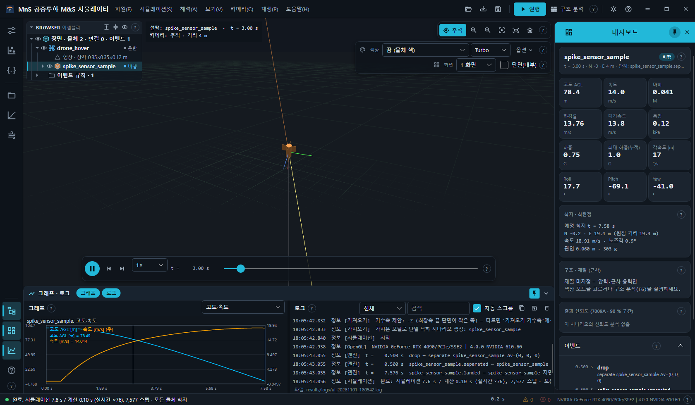
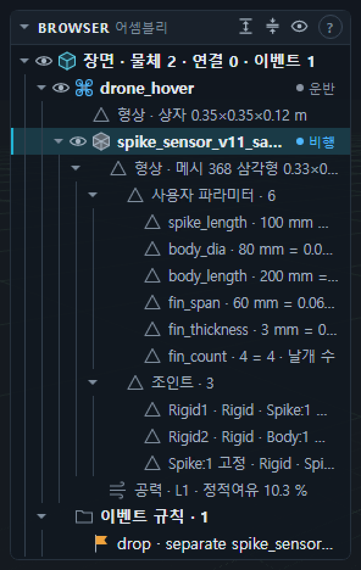
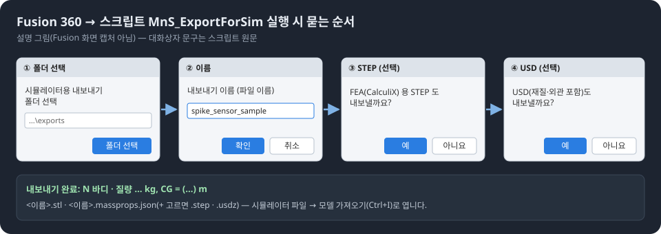

# 10. Fusion · Blender 연동

## 10.1 Fusion 모델 가져오기 (Ctrl+I)

파일 → **모델 가져오기 (Fusion STL/JSON)…**, 입력 서랍의 **모델 가져오기…**, **Ctrl+I**, 또는 `.stl` · `.massprops.json` 을 창에 끌어다 놓기.



| 상황 | 동작 |
| --- | --- |
| 물체를 선택한 상태(운반체 아님) | 그 물체의 형상 · 질량특성을 가져온 모델로 바꿈(시나리오의 다른 값은 유지) |
| 선택이 없을 때 | 가져온 모델로 **드론 호버 단일 낙하 시나리오**를 새로 만듦: 운반체 `drone_hover`(100 m 정지 비행), 0.5초에 분리, 바람 3 m/s(270°에서), dt 1 ms, 6DOF MC 100회 · 풍속/풍향 산포 |
| `*.massprops.json` | Fusion 질량특성(질량 · CG · 관성)과 STL 사용 |
| `*.stl` 만 | 같은 이름의 `.massprops.json` 이 옆에 있으면 그것을, 없으면 **질량 [kg]** 칸 값으로 균일 밀도 질량특성 계산(STL 단위 mm) |

가져온 뒤 바로 실행합니다. 세부 값은 시나리오 JSON 서랍에서 고칠 수 있습니다.

**모델 가져오기 옵션**(입력 서랍, 접힘):

- **질량 [kg]**(기본 1.0) — STL 만 가져올 때.
- **기수축** — `자동(형상 제안)` · `+X` `-X` `+Y` `-Y` `+Z` `-Z`. 자동은 최장축 양 끝 가운데 단면이 작은 쪽을 기수로 제안하고 로그에 알립니다(실패하면 `+Z`). 다르면 골라서 다시 가져오세요.

가져온 물체의 색은 Fusion 외관 색(내보내기 1.1 에 있을 때) → 없으면 가져오기 고유 색입니다. 공력은 메시 측면 투영으로 압력 중심을 자동 추정하고 감쇠는 가정값을 씁니다.

### 브라우저의 사용자 파라미터 · 조인트

Fusion 내보내기 1.1 의 질량특성에 사용자 파라미터 · 조인트가 있으면 물체의 **형상** 노드 아래에 **사용자 파라미터 · n** · **조인트 · n**(n = 개수) 묶음이 생깁니다(처음엔 접힘, 흐린 정보 행).

- 파라미터 행: `이름 · 식 = SI 값 단위 · 주석` (예: `arm_length · 250 mm = 0.25 m · …`). SI 값이 없으면 `(Fusion 내부 단위)`.
- 조인트 행: `이름 · 종류 · 부품1 ↔ 부품2 · 원점 (x, y, z) m` (+ `as-built` · `억제됨`).
- 마우스를 올리면 이름과 세부가 두 줄로 보입니다. 머리줄 **모두 펼치기** 로 한 번에 펼칩니다.
- 1.1 필드를 담은 공개 합성 샘플: `samples/fusion_export/spike_sensor_v11_sample.massprops.json`(스파이크 샘플 형상 + 재료 물성 · 외관 · 사용자 파라미터 · 조인트 예시값, `tools/samples/make_fusion11_sample.py`).



## 10.2 Fusion 내보내기 스크립트 (`tools/fusion/MnS_ExportForSim`)

Fusion 360 **스크립트**(추가 기능 아님)입니다.

1. Fusion: 유틸리티 → 추가 기능(Scripts and Add-Ins, Shift+S) → **스크립트** 탭 → `+` 로 `tools/fusion/MnS_ExportForSim` 폴더를 추가합니다.
2. 내보낼 바디/컴포넌트를 선택(없으면 보이는 모든 솔리드 바디)하고 **실행**.
3. 차례로 묻습니다: 폴더(`시뮬레이터용 내보내기 폴더 선택`) → 이름(`내보내기 이름 (파일 이름)`) →
   `FEA(CalculiX) 용 STEP 도 내보낼까요?` → `USD(재질·외관 포함)도 내보낼까요?`.
4. 끝나면 `내보내기 완료: N 바디 · 질량 … kg, CG = (…) m · <json 경로> · 경고` 를 보여 줍니다.



| 출력 | 내용 |
| --- | --- |
| `<이름>.stl` | 이진 STL, m 단위, Fusion 모델 좌표 |
| `<이름>.massprops.json` | `mns.massprops/1` — 질량 · CG · CG 기준 관성(SI) · 부품별 정보 |
| `<이름>.step` (선택) | FEA 용(여러 바디가 맞닿은 부품은 STEP 이어야 결합된 메시 — `mns ccx --cad`) |
| `<이름>.usdz` (선택) | 재질 · 외관 포함 USD(Blender `--usd` 가 STL 대신 사용) |

STEP · USD 실패는 경고만 남기고 질량특성 저장을 막지 않습니다.

### 내보내기 1.1 에서 더해진 정보 (`massprops.json`)

- 부품마다: `materialId` · `materialLibrary`, **재료 물성** `materialProperties`(SI — `density` kg/m³ · `E` · `yield` · `ultimate` Pa · `nu` · `thermalExpansion` 1/K ·
  `thermalConductivity` W/(m·K) · `specificHeat` J/(kg·K); 변환 실패분은 `materialPropertiesUnconverted`), **외관** `appearance`(`baseColor` 0–1 · `opacity` · `metallic` · `roughness`), `occurrence`.
- 최상위: `accuracy`(질량 계산 정확도) · `mesh`(정밀도 설정 · 실제 방법) · `userParameters[]`(이름 · 식 · 단위 · 값 · SI 값 · 주석) ·
  `joints[]`(이름 · 종류 · 출처 joint/asBuiltJoint · 부품 둘 · 원점 · 억제) · `step` · `usd`.

### `export_options.json` (스크립트 폴더, 선택)

없으면 1.0 과 같은 출력입니다.

| 키 | 값 · 기본 | 뜻 |
| --- | --- | --- |
| `mesh` | `"medium"`(기본) | STL 내보내기 중간 정밀도 |
| | `"fine"` | 표면 편차 0.02 mm · 법선 편차 5° — CFD · FEA 표면 메시용(파일이 수 배 커짐) |
| | `{ "preset", "surfaceDeviation_mm", "normalDeviation_deg", "maxEdgeLength_mm", "aspectRatio" }` | 직접 지정(`0` = 제한 없음, `surfaceDeviation_mm` > 0). 모르는 키는 오류 |
| `massAccuracy` | `"high"`(기본) · `"veryHigh"` | 질량특성 계산 정확도 |
| `usd` | `false`(기본) · `true` | USD 도 쓰기 — 대화형 실행에서는 마지막 질문의 답이 우선 |

메시 계산 결과가 바디 경계 상자와 맞지 않으면 같은 정밀도의 STL 내보내기로 대체하고 경고합니다.

### 여러 묶음 한 번에 (`tools/fusion/MnS_ExportGroups`, 저장소에 있을 때)

묶음 정의 JSON(환경 변수 `MNS_GROUPS_PARAMS`)대로 여러 묶음을 차례로 내보내고 `groups_summary.json` 을 씁니다. `mesh` · `massAccuracy` · `usd` 를 파일 최상위 또는 묶음별로(묶음 값 우선) 줄 수 있습니다.

## 10.3 Fusion 해석 패키지 (simpkg)

Fusion 의 해석 패키지(`.adsksimpkg`)를 읽어 요약하고, 정적 응력(LinearStress) 해석을 CalculiX 로 재현합니다.

```text
mns simpkg <pkg.adsksimpkg> [--step-dir DIR[;DIR…]] [--out DIR] [--run] [--install PATH] [--modal [--modes N]] [--converge [--converge-top N] [--converge-global]]
           [--mesh-max MM] [--mesh-min MM] [--mesh-thick N] [--fusion-report FILE [--fusion-legend "sf=…;vm=MPa;u=mm"]] [--design-results FILE [--design-case AX]] [--threads N]
```

| 옵션 | 기본 | 뜻 |
| --- | --- | --- |
| `--step-dir DIR[;DIR…]` | — | STEP 폴더(앞이 우선). 바디별 STEP 목록(`station.json` · `bodies.json`, 바디 이름 일치 · 부피 2 % 이내) 또는 `*.massprops.json` + 같은 이름 `.step`(순서 매칭) |
| `--out DIR` | `results/simpkg/<패키지 이름>` | 출력 폴더 |
| `--run` | 끔 | CalculiX 로 재현(C3D10 · 결합 접촉 `*TIE` · 고정 · 중력/가속). 정적 응력이 아닌 해석은 `not-run` 과 이유 |
| `--install PATH` | 자동 | CalculiX 위치 |
| `--modal` · `--modes N` | 끔 · 6 | 같은 고정 · TIE 로 고유진동(`*FREQUENCY`) 추가 |
| `--converge` · `--converge-top N` · `--converge-global` | 끔 · 10 · 끔 | 메시 수렴 2단계: 전역(모든 바디 h×2 → 기본) · 국부(안전율 하위 N 바디 h×½, `--converge-global` = 전부) |
| `--mesh-max MM` · `--mesh-min MM` | 모델 대각선의 2 % · 0.4 % | 요소 크기 상한 · 하한 |
| `--mesh-thick N` | 2 | 두께 방향 최소 요소 수(두께 t = 2V/A 로 추정) |
| `--fusion-report FILE` | — | Fusion 해석 보고서(.html/.htm/.txt) — 절점 · 요소 · 가속 · 결과 요약 표를 읽어 비교 |
| `--fusion-legend SPEC` | — | 결과 그림 범례에서 사람이 읽은 값 `sf=…;vm=<MPa>;u=<mm>;rf=<N>` (표 값을 덮어쓰지 않음) |
| `--design-results FILE` · `--design-case AX` | — · `AX` | 설계 쪽 FEA 결과 JSON 과 바디별 비교 |
| `--threads N` | 0 | CalculiX 스레드 |

- 출력: `study.json`(`mns.study/1`, 바디↔STEP 매칭) · `summary.json`(평형 · 반력 오차 · 안전율 최대/99 % · 바디별 두께 · 요소 · 이관 질량 …) · `report.md` · `result.vtu`(ParaView),
  작업 폴더 `catalog/` · `mesh/` · `ccx/`, `--converge` 면 `coarse/` · `half/`.
- 고정 바디에 결합되지 않은 바디는 메시에서 빼고 질량을 가장 가까운 해석 바디로 옮깁니다(보고서에 목록).
- `report.md`: 안전율 하위 10 바디(99 % 기준) · 최대 응력 상위 10 · 메시 수렴 · Fusion · 설계 결과와 비교 · 고유진동 표.
- 한글 바디 이름이 깨진(이중 인코딩) 패키지는 자동으로 복원하고 경고합니다.
- 고유진동 결과는 진동 피로 근사의 입력이 됩니다([8.9절](08-structural-impact.md#89-진동-피로-근사)).

## 10.4 Blender 결과 가져오기

결과 폴더(파일 → **결과 폴더 내보내기**, 또는 `mns run --out DIR`)를 Blender 애니메이션으로 만듭니다.

```text
blender --python tools/blender/import_mns_result.py -- <결과폴더> [--fps 25] [--scale 1.0] [--usd]
```

- `scene.json` · `timeseries.csv` · `devices.csv` · `meshes/*.stl` · `events.json` 을 읽어 물체마다 위치 · 쿼터니언 키를 넣습니다(엔진 NED → Blender ENU).
- 낙하산 = 반구(충만비 → 스케일 키, 미전개 → 숨김), 테더 = 양 끝 Empty 에 훅으로 연결된 커브, 이벤트 = 타임라인 마커.
- Blender 텍스트 편집기에서 `RESULT_DIR` 을 지정해 실행해도 됩니다.
- `--usd`: Fusion 이 재질 포함 USD 를 내보낸 물체(`scene.json` 의 `bodies[].usd = meshes/*.usdz`)는 STL 대신 USD 를 가져와 재질 · 외관을 유지합니다.
  축(Y-up ↔ Z-up) · 단위 배율 후보 가운데 동체 메시 경계 상자에 맞는 것으로 놓고(허용 오차 대각선의 5 %), 맞는 후보가 없으면 그 물체는 STL 로 대체합니다.
