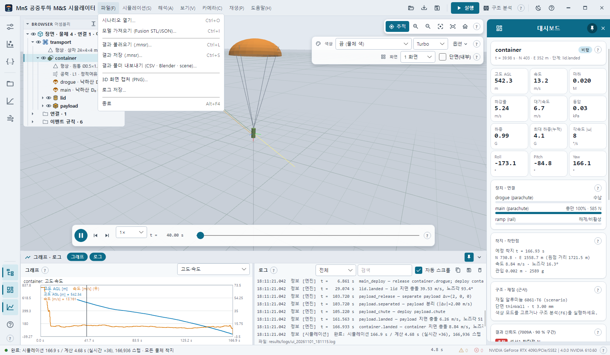

# 11. 결과 — 저장 · 불러오기 · 내보내기 · 캡처 · 로그

## 11.1 결과 저장 (.mnsr) — Ctrl+S

파일 → **결과 저장 (.mnsr)…** · 빠른 단추 저장 · 입력 서랍 **결과 저장…** · **Ctrl+S**. 기본 이름 `<시나리오>_<날짜_시각>.mnsr`.

`.mnsr` 은 zip 한 파일(`mns.result/1`)이며 계산 없이 그대로 다시 보는 데 필요한 것을 모두 담습니다:

| 항목 | 파일 |
| --- | --- |
| 요약 · 종료 상태 · 이벤트 · 경고 · 착지 · 물체 통계 | `result.json` |
| 원본 시나리오 · 자기완결 시나리오(질량특성 명시, 메시 포함) | `scenario.json` · `scenario.resolved.json` · `meshes/*.stl` |
| 전 프레임 | `frames.bin` |
| 요약 · 이벤트 · 시간 이력 · 장치 · 장면 | `summary.json` · `events.json` · `timeseries.csv` · `devices.csv` · `scene.json` |
| 구조 분석 (있으면) | `structural.json` |
| Monte Carlo (있으면) | `mc.json` |
| FEA (있으면 — CalculiX 기록 · OpenCourant 소성변형률) | `fea.json` |

저장이 끝나면 로그에 `저장: <경로> (… MB) — 파일 → 결과 불러오기(Ctrl+L)로 다시 볼 수 있음` 이 남고 창 제목에 파일 이름이 붙습니다.
결과가 없으면 `저장할 결과가 없습니다 — 먼저 실행(F5)하거나 결과를 불러오세요.`

## 11.2 결과 불러오기 (.mnsr) — Ctrl+L

파일 → **결과 불러오기 (.mnsr)…** · 빠른 단추 불러오기 · **Ctrl+L** · `.mnsr` 을 창에 끌어다 놓기.
3D 재생 · 대시보드 · 그래프 · 이벤트 · 요약 · MC · FEA 색을 계산 없이 복원합니다.
로그: `불러옴: <파일> — <시나리오> · 프레임 … · 종료 … s · 저장 <시각> · 구조 분석 포함(최대값 유지 색은 F6 로 다시 계산) · MC 포함 · FEA 결과 n개`.
시나리오 목록 선택은 비워집니다(파일에서 온 시나리오).

명령줄: `mns run … --archive r.mnsr` 로 만들고, `mns open r.mnsr` 로 요약을 봅니다.

## 11.3 결과 폴더 내보내기 (CSV · Blender · scene)…

폴더를 고르면 `<시나리오>_<날짜_시각>/` 에 씁니다 — 외부 도구 · Blender 용(앱에서 다시 여는 파일은 .mnsr).

| 파일 | 내용 |
| --- | --- |
| `timeseries.csv` | 물체별 NED 위치 · 쿼터니언 · 오일러 · 속도 · 하중 |
| `devices.csv` | 낙하산 충만 · 힘, 테더 장력 등 |
| `events.json` · `summary.json` · `scenario.json` | 이벤트 · 요약 · 시나리오 |
| `scene.json` + `meshes/` | Blender 가져오기용 장면 · 메시 |

Blender: `tools/blender/import_mns_result.py`([10.4절](10-fusion-blender.md#104-blender-결과-가져오기)). 명령줄 `mns run --out DIR` 도 같은 폴더를 만듭니다.

## 11.4 3D 화면 캡처 (PNG)…

현재 3D 뷰(분할이면 전체 GL 영역)를 PNG 로 저장합니다. 기본 이름 `view_<날짜_시각>.png`. 패널 · 메뉴는 들어가지 않습니다.
창 전체 그림은 스모크 실행의 `window.png` 로 만듭니다([14장](14-headless-smoke.md)).

## 11.5 로그 저장… · 로그 섹션

파일 → **로그 저장…** 또는 로그 섹션의 저장 단추 — 로그 전체를 `mns_log_<날짜_시각>.log` 로(로그 섹션의 복사 단추는 지금 보이는 줄만 클립보드로).
세션 로그는 따로 `results/logs/ui_<날짜_시각>.log` 에 계속 기록됩니다(처리 안 된 예외 · 정상 종료도 기록).

로그 한 줄: `시각  수준  [출처]  메시지`. 엔진 이벤트는 `[엔진] t = … s  <이벤트> — <설명>` 으로 최대 400줄까지, 수치 건전성 감시가 결과를 '의심(suspect)'으로 표시하면 경고가 남습니다.

## 11.6 결과 요약 복사

대시보드 **결과 요약** 을 펼치고 **요약 텍스트 복사** — 요약 전체를 텍스트로 클립보드에 넣습니다.
