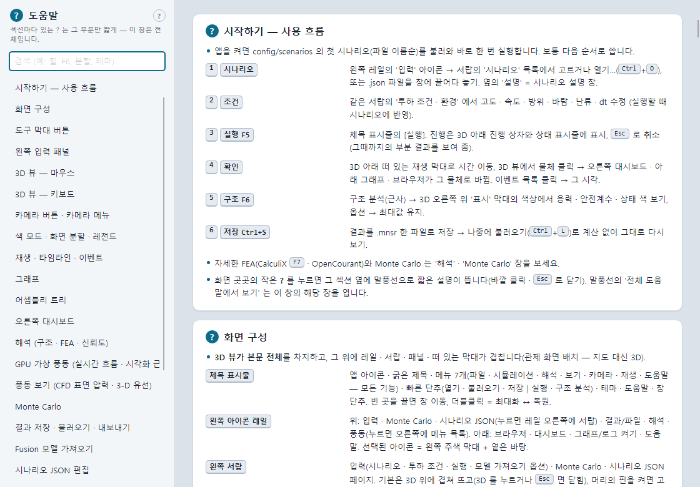

# 13. 단축키 전체 · 도움말 창

## 13.1 메인 창

### 파일 · 실행 · 해석

| 키 | 동작 |
| --- | --- |
| F1 | 도움말 창 |
| F5 | 시뮬레이션 실행 |
| F6 | 구조 분석 (근사) |
| F7 | 정적/진동/좌굴 FEA — CalculiX (선택 물체) |
| F8 | 풍동 보기 (CFD 표면 압력 · 유선) |
| Shift+F8 | GPU 가상 풍동 (실시간 흐름 · 시각화 근사) |
| Esc | 열린 ? 말풍선 닫기 → (없으면) 실행 중인 작업 취소 → (없으면) 겹쳐 뜬 왼쪽 서랍 닫기 |
| Ctrl+O | 시나리오 열기 |
| Ctrl+I | 모델 가져오기 (Fusion STL/JSON) |
| Ctrl+S | 결과 저장 (.mnsr) |
| Ctrl+L | 결과 불러오기 (.mnsr) |
| Ctrl+0 | 보기 기본값 — 모든 레이어 · 패널 · 숨긴 물체 표시 |
| Ctrl+B | 브라우저(어셈블리) 숨기기 · 보이기 |
| Ctrl+] · Ctrl+[ | 다음 · 이전 충격 창 (0.005× 슬로모션) |
| Alt+F4 | 종료 |

### 카메라 (입력칸 밖)

| 키 | 동작 |
| --- | --- |
| T | 선택 물체 추적 켜기/끄기 |
| C | 선택 물체로 확대 |
| F | 전체 보기 |
| Home | 카메라 초기화 (추적 켬) |
| + · − (숫자판 포함) | 확대 · 축소 |
| 1 · 2 · 3 · 4 (숫자판 포함) | 위에서(평면, 북쪽 위) · 정면(북) · 측면(동) · 등각 |
| W · S · A · D · E · Q (누르는 동안) | 전진 · 후진 · 왼쪽 · 오른쪽 · 상승 · 하강 |
| ← → ↑ ↓ | 화면 평면 이동 |
| Shift + 화살표 | 궤도 회전 |
| Ctrl + 화살표 | 제자리 시점 회전 (2°) |

Home · Space · PageUp/Down · 화살표 · W/S/A/D/E/Q 는 3D 뷰 · 단추에 포커스가 있거나 포커스가 없을 때만 동작합니다(목록 · 슬라이더 · 메뉴 탐색과 겹치지 않게).

### 재생

| 키 | 동작 |
| --- | --- |
| Space | 재생 / 일시정지 |
| , · . | 이전 · 다음 프레임 |
| PageUp · PageDown | 이전 · 다음 이벤트 |
| Ctrl+Home | 처음으로 |

### 그래프 (그래프를 클릭해 포커스가 있을 때)

| 키 · 조작 | 동작 |
| --- | --- |
| ← · → | 기록 간격 한 칸씩 시각 이동(Shift = 10칸) |
| 클릭 · 드래그 | 그 시각으로 |
| 휠 | 마우스 위치 기준 시간축 확대 · 축소 |
| 오른쪽 · 가운데 드래그 | 확대한 구간 이동 |
| 더블클릭 | 전체 범위 |

### 마우스 (3D 뷰)

왼쪽 드래그 = 궤도 회전 · Ctrl+왼쪽 드래그 = 시점 회전 · 오른쪽/가운데/Shift+왼쪽 드래그 = 이동 · 휠 = 확대 · Ctrl+휠 = 전진/후진 ·
클릭 = 선택 · 더블클릭 = 선택 + 확대(빈 곳 = 전체 보기). 자세히: [4장](04-3d-view-camera-playback.md#41-3d-뷰-조작).

## 13.2 보조 창

| 창 | 키 |
| --- | --- |
| 도움말 창 | Ctrl+F = 검색 칸 · Esc = 닫기 |
| 풍동 보기 (F8) | ← → 또는 , . = 받음각 케이스 이동 · Space = 입자 흐름 멈춤/다시 · F = 전체 보기 · Esc = 닫기 |
| GPU 가상 풍동 (Shift+F8) | ← → 또는 , . = 받음각 ±5° · Space = 일시정지 · F = 전체 보기 · Esc = 닫기 |
| 대화상자(재질 · 신뢰도 · CalculiX 옵션 · 시나리오 설명 · 업데이트) | Esc = 닫기(CalculiX 옵션: Enter = 실행) |

## 13.3 도움말 창 (F1)

- 왼쪽: 제목 · 검색 칸(`검색 (예: 휠, F6, 분할, 테마)`) · 목차. 오른쪽: 장마다 카드.
- 장: 시작하기 — 사용 흐름 · 화면 구성 · 도구 막대 버튼 · 왼쪽 입력 패널 · 3D 뷰 — 마우스 · 3D 뷰 — 키보드 · 카메라 버튼 · 카메라 메뉴 · 색 모드 · 화면 분할 · 레전드 ·
  재생 · 타임라인 · 이벤트 · 그래프 · 어셈블리 트리 · 오른쪽 대시보드 · 해석 (구조 · FEA · 신뢰도) · GPU 가상 풍동 · 풍동 보기 · Monte Carlo ·
  결과 저장 · 불러오기 · 내보내기 · Fusion 모델 가져오기 · 시나리오 JSON 편집 · 보기 메뉴 · 3D 레이어 · 테마 · 화면 모양 · 로그 · 상태 표시줄 · 업데이트 · 설치 · 정보 · 단축키 전체.
- 검색하면 장 제목 · 항목에서 찾은 것만 남깁니다. 섹션 ? 말풍선의 '전체 도움말에서 보기' 는 이 창의 그 장으로 이동합니다.
- 모달이 아니라 옆에 띄워 두고 조작할 수 있습니다. 이미 열려 있으면 앞으로 가져옵니다.

