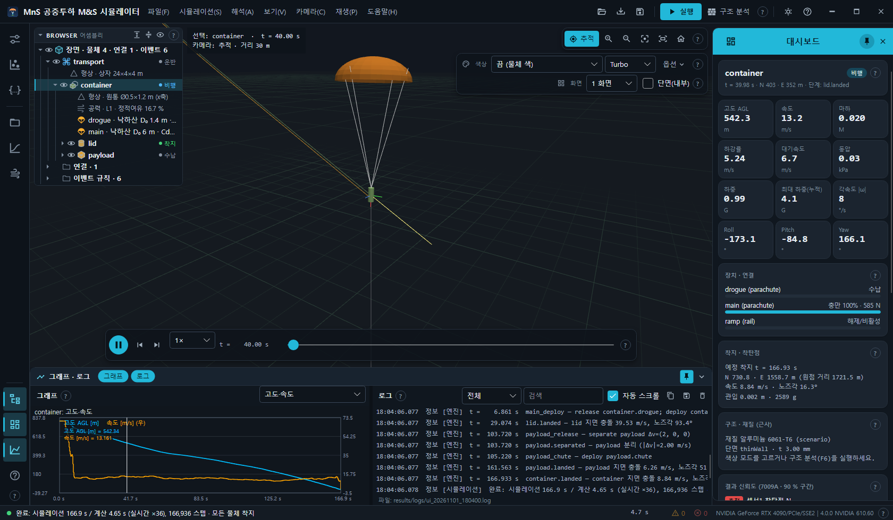

# Open M&S 사용자 매뉴얼

공중투하 6DOF M&S 시뮬레이터 **Open M&S** 의 데스크톱 앱(`MnS.Simulator.exe`)과 명령줄 도구(`mns`) 사용법입니다.
모든 설명은 실제 코드의 메뉴 · 단추 · 옵션 이름을 그대로 씁니다. 예시는 공개 데모 시나리오 3종(`config/scenarios/demo_*.json`)만 씁니다.

## 목차

| 장 | 내용 |
| --- | --- |
| [1. 설치 · 자동 업데이트 · 정보 · 제거](01-install-update.md) | 설치 프로그램 · 하루 한 번 자동 확인 · SHA-256 검증 업데이트 · 정보 창 · 제거 · 설치 프로그램 만들기 |
| [2. 빠른 시작](02-quick-start.md) | 첫 실행 · 데모 시나리오 열기 · 실행(F5) · 재생 |
| [3. 화면 구성](03-screen-layout.md) | 메뉴 · 레일 · 서랍 · 브라우저(어셈블리)와 오른쪽 클릭 메뉴 · 대시보드 · 그래프 · 로그 · 상태 표시줄 · 테마 |
| [4. 3D 뷰 · 카메라 · 재생 · 색상 · 분할 · 단면](04-3d-view-camera-playback.md) | 마우스 · 키보드 조작 · 카메라 · 재생 메뉴 · 색 모드 13종 · 1/2/4 분할 · 단면 · 보기 메뉴 전체 |
| [5. 장면 환경](05-scene-environment.md) | 하늘 · 지면 · 조명 7종 + 자동(토양) · 장면 설정 · 환경 파일 형식 |
| [6. 시나리오](06-scenario.md) | 열기 · 투하 조건 · JSON 편집 · 적용 · 검증 · 시나리오 설명 · 공개 데모 3종 |
| [7. Monte Carlo · 결과 신뢰도](07-monte-carlo-credibility.md) | GPU · 6DOF Monte Carlo · 분산 · CEP · NASA-STD-7009A 신뢰 등급 |
| [8. 구조 · 충격 · FEA](08-structural-impact.md) | 구조 분석(F6) · 하중 케이스 · CalculiX(F7) · 충격 응답 · 모달 과도 · OpenCourant · 재질 · 진동 피로 |
| [9. 유동](09-flow-wind-tunnel.md) | 풍동 보기(F8) · GPU 가상 풍동(Shift+F8) · OpenFOAM 결과 · 유동 영역 규칙 |
| [10. Fusion · Blender](10-fusion-blender.md) | 모델 가져오기(Ctrl+I) · Fusion 내보내기 스크립트 · 해석 패키지(simpkg) · Blender 결과 가져오기 |
| [11. 결과](11-results.md) | 결과 저장 · 불러오기(.mnsr) · 결과 폴더 내보내기 · 화면 캡처 · 로그 |
| [12. 명령줄 `mns`](12-cli.md) | 모든 명령과 옵션 · 예시 |
| [13. 단축키 · 도움말 창](13-shortcuts.md) | 단축키 전체 · 보조 창 키 · F1 도움말 |
| [14. 스모크 · 자동 점검](14-headless-smoke.md) | `--smoke` 옵션 전체 · 캡처 파일 · 스크린샷 재현 |

## 부록

- [대조 체크리스트](_checklist.md) — 코드의 모든 메뉴 · 패널 · 단축키 · 명령이 어느 장에서 설명되는지.
- [스크린샷 목록](_shots.json) — 각 그림을 어떤 데모 · 스모크 옵션으로 찍는지(`mns.shots/1`).
- 시나리오 형식: [docs/scenario-schema.md](../scenario-schema.md) · 장면 환경 형식: [config/environments/README.md](../../config/environments/README.md).

## 용어

| 용어 | 뜻 |
| --- | --- |
| 운반체 | 물체를 싣고 정해진 궤적으로 움직이는 비행체(시나리오 `carrier`) — 6DOF 를 풀지 않음 |
| 물체 | 6DOF 로 푸는 강체(시나리오 `bodies`). 수납(실린 상태) → 비행 → 착지 |
| 장치 | 물체에 달린 낙하산 · 로터 · 펄스 |
| 이벤트 | 조건(`when`)이 되면 동작(`do`: 분리 · 전개 · 해제 …)을 실행하는 규칙과 그 기록 |
| 근사 | FEA 가 아닌 빠른 응력 · 압력 계산(재생 시각마다) |
| CEP | 착지점의 50 % 가 들어가는 원 반지름 |
